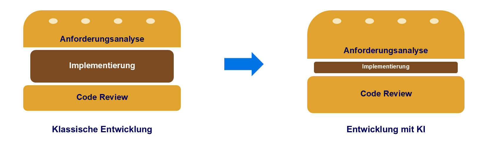
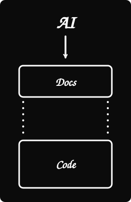
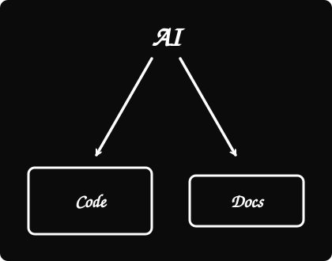
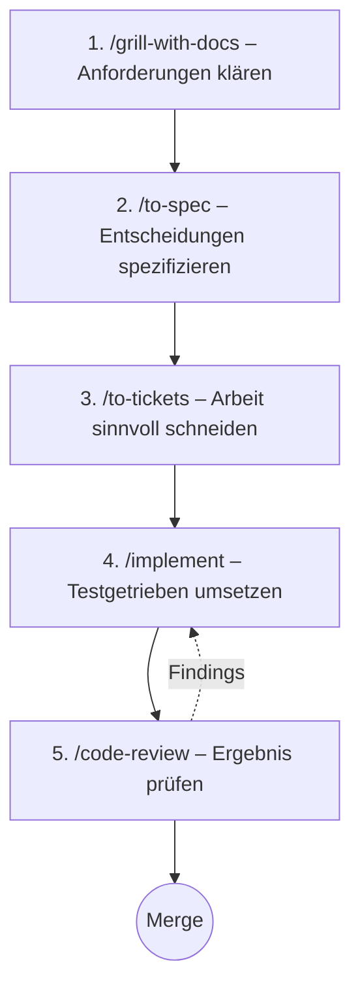

# KI-Blueprint

*Ein gemeinsamer Ansatz für den produktiven Einsatz von KI in der Softwareentwicklung*

**Grundlage:** Ergebnisse der Working Group „AI-Whitepaper“  
**Referenzprojekt:** RFP Manager (Frontend, Backend)  
**Status:** Living Document, gepflegt von der AI Working Group  
**Repository:** [github.com/DE-AMS-AD-TECUNIVERS/KI-Blueprint-Public](https://github.com/DE-AMS-AD-TECUNIVERS/KI-Blueprint-Public)  
**Kontakt:** ai-blueprint@atos.net

**Fragen zum Blueprint und zu seiner Einführung** richtet ihr am besten an unser Funktionspostfach. Darüber erreicht ihr die gesamte Working Group, die von Tobias Lösing geleitet wird.

## Einleitung – Ziel und Leseweg

Der Einsatz von KI-Agenten verändert zunehmend die Art und Weise, wie Software entwickelt wird. Während KI-Werkzeuge zunächst vor allem bei der Codegenerierung unterstützten, können heutige Agenten auch Anforderungen analysieren, Implementierungen planen, Tests ausführen und Code Reviews durchführen. Damit verschiebt sich die Arbeit von Entwicklern zunehmend von der eigentlichen Implementierung hin zur Planung, Steuerung und Überprüfung der Ergebnisse. Um diese Möglichkeiten sinnvoll zu nutzen, reicht es deshalb nicht aus, lediglich neue Werkzeuge in bestehende Entwicklungsprozesse einzubinden. Auch die Zusammenarbeit zwischen Mensch und Agent muss entsprechend gestaltet werden.

Dieser Blueprint beschreibt einen Entwicklungsansatz, den wir innerhalb der Working Group „AI-Whitepaper“ auf Grundlage unserer bisherigen Erfahrungen erarbeitet haben. Eine wesentliche Grundlage bilden dabei die im Referenzprojekt RFP Manager entwickelten und erprobten Arbeitsweisen. Ziel ist es, diese Erfahrungen für andere Teams zugänglich zu machen und eine gemeinsame Orientierung für die KI-gestützte Softwareentwicklung zu schaffen.

Im Mittelpunkt steht dabei nicht ein bestimmtes Modell oder Agent-Tool, sondern die Methodik, mit der KI-Agenten in den Entwicklungsprozess eingebunden werden. Wir betrachten deshalb nicht nur die Implementierung, sondern auch die Anforderungsanalyse, den Umgang mit Projektwissen und die Qualitätssicherung. Die vorgestellten Skills aus der Matt-Pocock-Library dienen als konkrete Umsetzung dieses Ansatzes und können an die Anforderungen einzelner Projekte angepasst werden.

Der Blueprint ist in einen erklärenden und einen praktischen Teil gegliedert. Kapitel 1 beschreibt zunächst die Entstehung des Ansatzes im RFP Manager. In den Kapiteln 2 bis 7 erläutern wir die dahinterliegenden Überlegungen, den AI Workflow, seine Qualitätsanforderungen und die Möglichkeiten zur Weiterentwicklung. Kapitel 8 führt anschließend durch die konkrete Einführung in einem eigenen Projekt. Wer sich zunächst mit den Grundlagen beschäftigen möchte, kann das Dokument von Anfang an lesen. Teams, die direkt mit der Umsetzung beginnen möchten, können dagegen bei Kapitel 8 einsteigen und die entsprechenden Hintergründe bei Bedarf nachlesen.

Ergänzend behandelt Anhang A Möglichkeiten zur Optimierung des Token-Verbrauchs. Diese sind insbesondere für Teams mit begrenzten Modellbudgets interessant, gehören jedoch nicht zu den Voraussetzungen für die Anwendung unseres Entwicklungsansatzes. Anhang B richtet sich an Projekte, die sich über mehrere Repositories verteilen, und ergänzt die Anleitung aus Kapitel 8 um Empfehlungen für diesen Fall. Anhang C enthält den Setup-Prompt aus Kapitel 8 zum direkten Kopieren.

Der Blueprint basiert auf unseren bisherigen praktischen Erfahrungen und den daraus abgeleiteten Empfehlungen. Da sich die Möglichkeiten von KI-Agenten und die Erfahrungen im täglichen Einsatz kontinuierlich weiterentwickeln, verstehen wir das Dokument als Living Document, das durch Rückmeldungen und Erkenntnisse aus weiteren Projekten ergänzt und verbessert werden soll.

### Inhalt

1. [Wie der Ansatz entstanden ist – der RFP Manager](#1-wie-der-ansatz-entstanden-ist-der-rfp-manager)
2. [Warum sich die Entwicklungsarbeit verschiebt](#2-warum-sich-die-entwicklungsarbeit-verschiebt)
3. [Wissen ins Repo – die Grundlage für KI-gestützte Entwicklung](#3-wissen-ins-repo-die-grundlage-für-ki-gestützte-entwicklung)
4. [Der AI Workflow: von der Idee bis zum Merge](#4-der-ai-workflow-von-der-idee-bis-zum-merge)
5. [Definition of Done 2.0: wann Arbeit wirklich fertig ist](#5-definition-of-done-20-wann-arbeit-wirklich-fertig-ist)
6. [Vom Standard zum projektspezifischen Ansatz](#6-vom-standard-zum-projektspezifischen-ansatz)
7. [Weitere nützliche Skills für den Entwicklungsalltag](#7-weitere-nützliche-skills-für-den-entwicklungsalltag)
8. [Der Weg ins eigene Projekt](#8-der-weg-ins-eigene-projekt)

**Optionale Vertiefung:** [Anhang A – Token-Optimierung](#anhang-a-token-optimierung-als-optionale-vertiefung)  
**Für Projekte mit mehreren Repositories:** [Anhang B – Projekte mit mehreren Repositories](#anhang-b-projekte-mit-mehreren-repositories)  
**Zum Kopieren:** [Anhang C – Setup-Prompt zur Grundbefüllung](#anhang-c-setup-prompt-zur-grundbefüllung)

---

## 1. Wie der Ansatz entstanden ist: der RFP Manager

Der hier beschriebene Workflow wurde nicht rein theoretisch entworfen. Er ist aus dem aktiven Einsatz und den Erfahrungen im Referenzprojekt **RFP Manager** gewachsen und von der Working Group zu einem sauber dokumentierten Leitfaden ausgearbeitet worden.

Der RFP Manager ist ein Pflichttool der Sales-Pipeline. Das Projekt startete mit einem kleinen Core-Team und wird inzwischen von einem mehrköpfigen Entwicklungsteam weiterentwickelt.

Für die Entstehung unseres Entwicklungsansatzes waren weniger die fachlichen Besonderheiten des RFP Managers ausschlaggebend als vielmehr die Erfahrungen, die wir im Laufe der Entwicklung mit dem Einsatz von KI gesammelt haben. Von Beginn an spielte KI eine zentrale Rolle bei der Umsetzung des Projekts. Dabei zeigte sich schnell, dass die reine Beschleunigung der Implementierung zwar enorme Möglichkeiten eröffnet, gleichzeitig aber neue Herausforderungen mit sich bringt. Während die eigentliche Umsetzung zunehmend weniger Zeit in Anspruch nahm, verlagerte sich der Aufwand auf andere Phasen des Entwicklungsprozesses. Dadurch entstanden neue Engpässe, die einen Teil der gewonnenen Zeitersparnis wieder aufzehrten und deutlich machten, dass eine schnellere Implementierung allein noch keinen effizienteren Entwicklungsprozess bedeutet.

Eine weitere Herausforderung bestand darin, bereits vorhandenes Projektwissen bei der Umsetzung zuverlässig zu berücksichtigen. Viele fachliche Zusammenhänge und technische Entscheidungen waren den beteiligten Entwicklern aus früheren Tickets, Abstimmungen und Gesprächen bereits bekannt. Für andere Teammitglieder und insbesondere für KI-Agenten war dieser Kontext jedoch häufig nicht verfügbar. Dadurch wurden längst geklärte Fragen erneut aufgeworfen, bestehende Entscheidungen hinterfragt oder Lösungen vorgeschlagen, die aus guten Gründen zuvor verworfen worden waren. Auch in der klassischen Entwicklung war die Weitergabe dieses Wissens eine Herausforderung. Allerdings blieb durch die längere Implementierungsphase meist mehr Zeit, fehlenden Kontext durch Rückfragen und Abstimmungen nachträglich zu klären. Wenn ein Agent dagegen innerhalb kürzester Zeit umfangreiche Änderungen umsetzen kann, wird es umso wichtiger, dass die relevanten Informationen und Entscheidungen bereits zu Beginn der Arbeit verfügbar sind. Das gilt umso mehr, wenn neue Teammitglieder hinzukommen und sich in bestehende Zusammenhänge einarbeiten müssen.

Aus diesen Erfahrungen entwickelte sich unser Ansatz schrittweise weiter. Um die neu entstandenen Herausforderungen zu bewältigen, haben wir unsere Arbeitsweise immer wieder hinterfragt, unterschiedliche Lösungsansätze ausprobiert und erfolgreiche Verbesserungen in den Entwicklungsalltag übernommen. Was zunächst aus einzelnen Maßnahmen bestand, wurde auf diese Weise nach und nach zu einem strukturierten Entwicklungsprozess zusammengeführt. Im Mittelpunkt stand dabei immer die Frage, wie sich die Möglichkeiten von KI möglichst effektiv nutzen lassen, ohne dass die gewonnene Geschwindigkeit durch zusätzliche Abstimmungen, aufwendige Nacharbeit oder vermeidbare Fehler wieder verloren geht.

Die dabei gewonnenen Erkenntnisse und entwickelten Arbeitsweisen haben sich nicht nur im RFP Manager bewährt, sondern wurden auch von Mitgliedern der Working Group in unterschiedlichen Projekten erfolgreich eingesetzt. Da sie auf grundlegenden Herausforderungen bei der Softwareentwicklung mit KI-Agenten aufbauen, lassen sie sich unabhängig vom konkreten Projektkontext anwenden. Deshalb haben wir uns entschieden, die gesammelten Erfahrungen in diesem Blueprint zusammenzuführen und daraus einen gemeinsamen Best-Practice-Ansatz abzuleiten, den andere Entwicklungsteams als Grundlage für ihre eigene Arbeit nutzen können.

Wer den beschriebenen Ansatz in der Praxis kennenlernen möchte, erreicht uns über das Funktionspostfach ai-blueprint@atos.net. Darüber geben wir gerne Einblicke in die im RFP Manager eingesetzten Skills, Domain-Docs und Workflows und unterstützen bei der Einführung im eigenen Projekt.

Die Erfahrungen aus dem RFP Manager bilden den Ausgangspunkt für die folgenden Kapitel. Zunächst betrachten wir, wie der Einsatz von KI-Agenten die Entwicklungsarbeit verändert und welche Herausforderungen sich daraus ergeben. Anschließend leiten wir daraus die grundlegenden Prinzipien unseres Ansatzes ab und erläutern, wie diese in der Praxis zusammenspielen. Darauf aufbauend stellen wir den konkreten AI Workflow, die zugehörigen Qualitätsstandards und die Möglichkeiten zur projektspezifischen Weiterentwicklung vor. Den Abschluss bildet eine Schritt-für-Schritt-Anleitung, mit der sich der Ansatz in das eigene Projekt übertragen lässt.

---

## 2. Warum sich die Entwicklungsarbeit verschiebt

Die erste Erfahrung mit einem leistungsfähigen Coding-Agenten ist häufig beeindruckend: Aufgaben, für die zuvor Stunden oder Tage benötigt wurden, werden in deutlich kürzerer Zeit umgesetzt. Boilerplate, Tests oder die Verbindung einzelner Komponenten lassen sich weitgehend automatisieren. Es liegt deshalb nahe, KI zunächst als eine Möglichkeit zu betrachten, die bisherige Entwicklung einfach schneller zu machen. Dieser Eindruck ist nicht falsch, greift aber zu kurz.

Während die Implementierung durch den Einsatz von KI-Agenten deutlich beschleunigt wird, gewinnen die Anforderungsanalyse und die anschließende Überprüfung der Ergebnisse zunehmend an Bedeutung. Da die eigentliche Umsetzung immer weniger Zeit beansprucht, entfällt ein entsprechend größerer Anteil der gesamten Entwicklungszeit auf die sorgfältige Klärung der Anforderungen und das Code Review. Ein Agent kann in kurzer Zeit sehr viel Code auf Grundlage einer ungenauen Beschreibung erzeugen. Die Geschwindigkeit hilft in diesem Fall jedoch nicht, sondern vergrößert das Problem. Eine Fehlannahme wird nicht mehr nach und nach in eine Implementierung übertragen, sondern unmittelbar in eine ganze Reihe scheinbar fertiger Änderungen. Gleichzeitig wirkt KI-generierter Code oft plausibel. Er kompiliert, ist lesbar strukturiert und kann sogar grüne Tests mitbringen. Daraus folgt aber noch nicht, dass er die fachlich richtige Lösung darstellt, die Sicherheitsanforderungen des Projekts erfüllt oder zur bestehenden Architektur passt.



Die Abbildung verdeutlicht diese Verschiebung der Aufwandsverteilung, die wir auch im RFP Manager beobachten konnten. Dort zeigte sich mit zunehmendem KI-Einsatz, dass insbesondere die Anforderungsanalyse und das Code Review zu den entscheidenden Engpässen des Entwicklungsprozesses wurden. Das bedeutete allerdings nicht, dass der Einsatz von KI weniger sinnvoll war. Vielmehr wurde deutlich, dass wir unsere Arbeitsweise auch in den übrigen Entwicklungsphasen weiterentwickeln mussten, um das volle Potenzial der Technologie auszuschöpfen.

Deshalb begannen wir im RFP Manager, KI nicht mehr ausschließlich für die Implementierung einzusetzen, sondern auch die übrigen Phasen der Softwareentwicklung gezielt durch Agenten zu unterstützen. So konnten Anforderungen bereits vor der Umsetzung strukturiert hinterfragt und offene Fragen geklärt werden, während die anschließende Überprüfung der Ergebnisse ebenfalls durch KI unterstützt wurde. Auf diese Weise entwickelte sich schrittweise eine Arbeitsweise, die nicht nur die Codegenerierung beschleunigt, sondern den gesamten Entwicklungsprozess effizienter und zuverlässiger gestalten soll.

Entscheidend ist dabei, dass sich der Aufwand nicht nur verlagert, sondern unterm Strich tatsächlich Zeit eingespart wird. Denn auch die Phasen, die durch den KI-Einsatz an Gewicht gewonnen haben, lassen sich mit Unterstützung von Agenten schneller abschließen als auf rein manuellem Weg. Eine strukturierte, KI-gestützte Anforderungsanalyse führt in der Regel deutlich schneller zu belastbaren Entscheidungen als verteilte Abstimmungsrunden und dokumentiert diese Entscheidungen gleich mit. Im Code Review übernimmt der Agent die systematische Prüfung jeder einzelnen Änderung, sodass sich der menschliche Reviewer auf die fachliche Bewertung konzentrieren kann, anstatt den gesamten Diff selbst durchzugehen. Auf diese Weise werden alle drei Phasen schneller als ihre manuelle Entsprechung: die Implementierung drastisch, Anforderungsanalyse und Review deutlich. Erst dieses Zusammenspiel, nicht die schnelle Codegenerierung allein, macht den eigentlichen Produktivitätsgewinn aus.

Aus diesen Erfahrungen leiten wir drei grundlegende Prinzipien ab, die unseren Entwicklungsansatz maßgeblich prägen. Zwei davon ergeben sich unmittelbar aus der beschriebenen Verschiebung. „Denken vor Code“ stellt sicher, dass Anforderungen und Entscheidungen bereits vor der Implementierung ausreichend geklärt werden, um Fehlentwicklungen möglichst früh zu vermeiden. Das Prinzip „Qualitätssicherung mit KI“ erweitert den Einsatz von KI auf die anschließende Überprüfung der Ergebnisse. Indem Agenten einen wesentlichen Teil des Code Reviews übernehmen, kann die Qualität der Implementierung systematisch abgesichert und gleichzeitig der menschliche Review-Aufwand reduziert werden. Das dritte Prinzip, „Wissen ins Repo“, betrifft die Wissensbasis, die eine zuverlässige Zusammenarbeit zwischen Entwicklern und KI-Agenten erst ermöglicht. Ihr widmen wir uns im nächsten Kapitel, bevor wir zeigen, wie unser AI Workflow alle drei Prinzipien in der Praxis umsetzt.

---

## 3. Wissen ins Repo: die Grundlage für KI-gestützte Entwicklung

Eine der Herausforderungen, die wir bereits bei der Entwicklung des RFP Managers kennengelernt haben, ist der fehlende Projektkontext bei der Zusammenarbeit mit KI-Agenten. Fachliche Zusammenhänge, frühere Abstimmungen und bewusst getroffene Entscheidungen sind den beteiligten Entwicklern häufig bekannt, stehen einem Agenten in einer neuen Session jedoch nicht automatisch zur Verfügung. Dadurch kann es passieren, dass bereits geklärte Fragen erneut aufgeworfen oder bestehende Lösungen infrage gestellt werden, weil die Gründe für ihre Umsetzung nicht bekannt sind. Um solche Situationen zu vermeiden, ist es sinnvoll, relevantes Projektwissen dauerhaft verfügbar zu machen, sodass Agenten bei Bedarf selbstständig darauf zugreifen können.

Ein naheliegender Ansatz besteht darin, den verfügbaren Kontext durch zusätzliche Dokumentation zu erweitern. Dabei wird jedoch häufig versucht, den bestehenden Code möglichst ausführlich in natürlicher Sprache zu beschreiben. Es entstehen Modulübersichten, Funktionsbeschreibungen oder Erklärungen einzelner Abläufe, die im Wesentlichen wiedergeben, was bereits im Quellcode steht. Für neue Teammitglieder kann eine solche Dokumentation durchaus hilfreich sein, um sich schneller einen Überblick zu verschaffen. Für KI-Agenten ist ihr zusätzlicher Nutzen dagegen gering, da sie den Code selbst lesen und analysieren können. Gleichzeitig entsteht ein erheblicher Pflegeaufwand, weil jede relevante Codeänderung auch in der Dokumentation nachvollzogen werden müsste. Geschieht das nicht, können widersprüchliche Informationen entstehen, bei denen der Agent nicht mehr zuverlässig unterscheiden kann, welche Quelle den aktuellen Stand beschreibt. Die folgende Abbildung verdeutlicht dieses Problem, indem sie die Dokumentation als zusätzliche Schicht darstellt, die lediglich den darunterliegenden Code beschreibt, ohne dem Agenten wesentlich neue Informationen zu liefern.



Was einem Agenten tatsächlich häufig fehlt, ist nicht die Beschreibung dessen, was der Code tut, sondern die Begründung, warum er genau so umgesetzt wurde. Angenommen, ein API-Endpunkt verarbeitet eine Anfrage bewusst synchron, obwohl für vergleichbare Anwendungsfälle häufig eine asynchrone Verarbeitung eingesetzt wird. Der Agent kann im Code problemlos erkennen, wie die Verarbeitung funktioniert. Was er daraus jedoch nicht zuverlässig ableiten kann, ist, ob diese Umsetzung bewusst gewählt wurde, beispielsweise weil ein angebundenes System eine unmittelbare Rückmeldung benötigt. Ohne dieses Wissen könnte er die bestehende Lösung als verbesserungswürdig einstufen und bei jeder späteren Änderung erneut eine asynchrone Verarbeitung vorschlagen oder im schlimmsten Fall die Logik anpassen und damit einen kritischen Bug erzeugen. Ist die ursprüngliche Entscheidung dagegen mit ihrer Begründung dokumentiert, kann der Agent sie unmittelbar nachvollziehen und bei seiner Arbeit berücksichtigen.

Daraus ergibt sich ein grundlegend anderer Anspruch an die Projektdokumentation. Anstatt den Code ein zweites Mal in Textform abzubilden, sollten wir vor allem die Informationen festhalten, die sich aus dem Code allein nicht erschließen lassen. Dazu gehören fachliche Zusammenhänge, bewusst gewählte Architekturentscheidungen, verworfene Alternativen und projektspezifische Konventionen. Code und Dokumentation erfüllen damit unterschiedliche Aufgaben und ergänzen sich gegenseitig. Während der Code beschreibt, wie das System tatsächlich funktioniert, liefert die Dokumentation den notwendigen Hintergrund, um bestehende Lösungen zu verstehen und neue Entscheidungen im richtigen Kontext zu treffen. Die folgende Abbildung stellt diesen Ansatz der zuvor gezeigten Struktur gegenüber. Code und Dokumentation bilden nun zwei eigenständige, sich ergänzende Wissensquellen, aus denen der Agent je nach Fragestellung die benötigten Informationen beziehen kann.



Neben den Hintergründen technischer Entscheidungen gibt es noch eine weitere Art von Projektwissen, die sich nicht ohne Weiteres aus dem Code erschließen lässt. Gerade bei fachlichen Begriffen ist für die beteiligten Entwickler häufig selbstverständlich, was damit gemeint ist, weil sich ihre Bedeutung aus früheren Gesprächen und dem gemeinsamen Verständnis der Domäne ergibt. Ein KI-Agent kennt diesen Kontext jedoch nicht zwangsläufig. Er kann einen Begriff anders interpretieren, als er im Projekt verwendet wird, oder mit einer domänenspezifischen Bezeichnung zunächst überhaupt nichts anfangen. Solche Missverständnisse führen nicht nur zu wiederholten Rückfragen, sondern können sich auch unmittelbar auf die Implementierung auswirken, wenn der Agent auf Grundlage einer falschen Begriffsinterpretation arbeitet. Deshalb ist es sinnvoll, häufig verwendete Fachbegriffe in einem zentralen Glossar eindeutig zu definieren. So entsteht ein gemeinsames Vokabular, auf das sowohl Entwickler als auch Agenten zurückgreifen können, ohne die Bedeutung einzelner Begriffe immer wieder neu klären zu müssen.

Beide Beispiele verdeutlichen den Grundgedanken unseres dritten Prinzips „Wissen ins Repo“. Relevantes Projektwissen soll nicht ausschließlich in Gesprächen, Chatverläufen oder den Köpfen einzelner Entwickler verbleiben, sondern dauerhaft und für das gesamte Team zugänglich sein. Dabei geht es ausdrücklich nicht darum, möglichst viel zu dokumentieren, sondern gezielt die Informationen festzuhalten, die für das Verständnis des Projekts notwendig sind und sich nicht bereits aus dem Code ergeben. So entsteht eine gemeinsame Wissensbasis, auf die Entwickler und KI-Agenten bei Bedarf selbstständig zurückgreifen können. Wie diese Wissensbasis im Repository aufgebaut werden kann und welche Dokumentationsformen sich dafür eignen, betrachten wir im Folgenden.

### 3.1 Projektwissen dort ablegen, wo es gebraucht wird

Damit KI-Agenten auf das vorhandene Projektwissen zugreifen können, muss dieses zunächst an einem Ort abgelegt werden, der für alle Beteiligten gleichermaßen zugänglich ist. Dafür bietet sich das Repository des Projekts an. Würde jeder Entwickler seine Dokumentation lediglich lokal verwalten, hätte er zwar selbst Zugriff auf die eigenen Entscheidungen und Erkenntnisse, nicht jedoch auf die seiner Kollegen. Auch Agenten könnten dann immer nur auf einen Teil des tatsächlich vorhandenen Wissens zurückgreifen. Werden diese Informationen dagegen gemeinsam mit dem Code im Repository gepflegt, entsteht eine zentrale Wissensbasis, die allen Teammitgliedern zur Verfügung steht. Gleichzeitig lassen sich Änderungen an der Dokumentation versionieren, nachvollziehen und wie gewöhnliche Codeänderungen über Pull Requests überprüfen.

Dabei ist es sinnvoll, unterschiedliche Arten von Projektwissen voneinander zu trennen, da nicht jede Information für jede Aufgabe gleichermaßen relevant ist. Den Ausgangspunkt bilden allgemeine Projektanweisungen, die ein Agent grundsätzlich kennen und bei seiner Arbeit berücksichtigen soll. Dafür wird häufig eine Datei namens `AGENTS.md` verwendet, wobei Bezeichnung und Ablageort je nach eingesetztem Agent-Tool variieren können. In einer solchen Datei werden beispielsweise grundlegende Architekturregeln, Modulgrenzen, Namenskonventionen und projektspezifische Vorgaben festgehalten. Sie übernimmt damit die Rolle einer gemeinsamen Arbeitsanweisung, an der sich Agenten bei jeder neuen Aufgabe orientieren können. Gerade weil diese Informationen regelmäßig in den Kontext geladen werden, sollte die Datei möglichst kompakt bleiben und sich auf tatsächlich übergreifende Regeln beschränken. In größeren Projekten können ergänzende Anweisungsdateien für einzelne Teilbereiche sinnvoll sein, damit ein Agent nur die jeweils relevanten Vorgaben berücksichtigen muss.

Nicht alle Informationen müssen jedoch dauerhaft Bestandteil der allgemeinen Agentenanweisungen sein. Für das zuvor beschriebene Problem uneindeutiger oder domänenspezifischer Begriffe eignet sich beispielsweise eine eigene Glossar-Datei, etwa `GLOSSARY.md`. Darin werden die im Projekt verwendeten Fachbegriffe und ihre jeweilige Bedeutung festgehalten. Auf diese Weise entsteht ein einheitliches Vokabular, das sowohl bei der Formulierung neuer Anforderungen als auch bei deren Umsetzung verwendet werden kann. Wenn ein Agent auf einen ihm unbekannten oder mehrdeutigen Begriff stößt, kann er dessen Bedeutung gezielt im Glossar nachschlagen, anstatt eigene Annahmen zu treffen oder bereits geklärte Fragen erneut zu stellen.

Für die Dokumentation wichtiger Entscheidungen und ihrer Hintergründe verwenden wir im RFP Manager sogenannte Architecture Decision Records (ADRs), die direkt im Repository unter `docs/adr/` abgelegt werden. Darin halten wir insbesondere Architekturentscheidungen und ihre Begründungen fest, sodass Entwickler und Agenten diese auch bei späteren Änderungen nachvollziehen können.

Auf diese Weise erhält jede Art von Projektwissen ihren eigenen Platz. Allgemeine Vorgaben stehen in den Agentenanweisungen, fachliche Begriffe im Glossar und wichtige Entscheidungen mit ihren Begründungen in entsprechenden Dokumenten wie den ADRs. Der Agent muss somit nicht bei jeder Aufgabe sämtliche Informationen erhalten, sondern kann auf eine gemeinsame Wissensbasis zurückgreifen und die jeweils benötigten Inhalte gezielt heranziehen. Wie diese Dateien im Entwicklungsalltag entstehen, wann sie aktualisiert werden und wie sich ihre Pflege in den Einsatz von KI-Agenten integrieren lässt, erläutern wir im Folgenden anhand unseres AI Workflows.

Das klingt zunächst nach einem erheblichen zusätzlichen Dokumentationsaufwand, der die gewonnene Zeitersparnis wieder zunichtemachen könnte. In unserem AI Workflow ist die Pflege dieser Wissensbasis jedoch direkt in den Entwicklungsprozess integriert und wird weitgehend von KI-Agenten übernommen, sodass die Dokumentation während der ohnehin notwendigen Arbeitsschritte entsteht und im Alltag kaum zusätzlichen Aufwand verursacht. Wie das konkret funktioniert, erläutern wir in den folgenden Kapiteln.

## 4. Der AI Workflow: von der Idee bis zum Merge

In den vorherigen Kapiteln haben wir betrachtet, welche Herausforderungen durch den zunehmenden Einsatz von KI-Agenten in der Softwareentwicklung entstehen und welche grundlegenden Prinzipien sich daraus ableiten lassen. Dabei wurde deutlich, dass die Beschleunigung der Implementierung allein nicht ausreicht, um den gesamten Entwicklungsprozess effizienter zu gestalten. Ebenso wichtig sind eine sorgfältige Anforderungsanalyse, eine zuverlässige Qualitätssicherung und die dauerhafte Verfügbarkeit des Projektwissens. Entscheidend ist nun, diese Aspekte nicht isoliert zu betrachten, sondern sie in einer gemeinsamen Arbeitsweise miteinander zu verbinden.

Genau dafür haben wir im RFP Manager unseren AI Workflow entwickelt. Statt KI-Agenten erst bei der Implementierung einzusetzen, begleiten sie den gesamten Entwicklungsprozess von der ersten Idee bis zur abschließenden Überprüfung. Dabei unterstützen sie nicht nur die Klärung von Anforderungen und das Code Review, sondern übernehmen gleichzeitig die Dokumentation der erarbeiteten Erkenntnisse und Entscheidungen. Die im vorherigen Kapitel beschriebene Wissensbasis wird damit unmittelbar in die tägliche Entwicklungsarbeit integriert. Vorhandenes Projektwissen kann bei der Bearbeitung neuer Aufgaben berücksichtigt werden, während neue Erkenntnisse direkt dort festgehalten werden, wo sie auch für spätere Arbeiten zur Verfügung stehen. So wird die Dokumentation zu einem festen Bestandteil des Workflows, ohne dass dafür ein eigenständiger, aufwendiger Arbeitsschritt notwendig ist.

Aus diesen Überlegungen ist ein strukturierter Entwicklungsprozess mit fünf aufeinander aufbauenden Schritten entstanden. Er führt von der gemeinsamen Klärung einer Idee über die Vorbereitung und Umsetzung bis zur abschließenden Qualitätsprüfung. Jeder Schritt verfolgt dabei ein eigenes Ziel und schafft die Grundlage für die darauffolgende Arbeit. Der folgende Ablauf veranschaulicht diesen Zusammenhang.



Damit dieser Ablauf im Entwicklungsalltag einfach und einheitlich angewendet werden kann, nutzen wir im RFP Manager die Skills der Matt-Pocock-Library. Ein Skill enthält eine wiederverwendbare Arbeitsanweisung, die festlegt, wie ein KI-Agent bei einer bestimmten Aufgabe vorgehen soll. Entwickler müssen dadurch nicht bei jeder neuen Session selbst einen ausführlichen Prompt formulieren, sondern können auf ein bereits ausgearbeitetes Vorgehen zurückgreifen. Die Library hat sich sowohl im RFP Manager als auch in weiteren Projekten der Working Group bewährt, weshalb wir sie als Ausgangspunkt für den eigenen Einsatz empfehlen. Im Vordergrund steht für uns allerdings die Methodik und nicht die konkrete technische Umsetzung. Die beschriebenen Arbeitsschritte können ebenso mit anderen Skills oder selbst entwickelten Agenten umgesetzt werden, solange die grundlegende Vorgehensweise erhalten bleibt.

Ein wesentlicher Bestandteil des Workflows ist außerdem, dass die Ergebnisse der einzelnen Schritte nicht ausschließlich im Gespräch mit dem Agenten verbleiben. Stattdessen entstehen nachvollziehbare Artefakte, auf die bei der weiteren Entwicklung zurückgegriffen werden kann. Damit baut jeder Arbeitsschritt auf den zuvor erarbeiteten Ergebnissen auf, ohne dass der gesamte Gesprächsverlauf erneut benötigt wird. Gleichzeitig wird es möglich, die Arbeit zwischen unterschiedlichen Entwicklern oder Agenten zu übergeben und zu einem späteren Zeitpunkt fortzusetzen. Die folgende Übersicht zeigt, womit jeder Schritt arbeitet und welches Artefakt er hinterlässt:

| # | Skill | Input | Ergebnis-Artefakt |
|---|---|---|---|
| 1 | `/grill-with-docs` | Eine grobe Idee | Geklärter Plan sowie aktualisierte Domain-Docs (`GLOSSARY.md`, ADRs) |
| 2 | `/to-spec` | Das Gespräch aus dem Grilling | Spezifikation als Issue im Tracker |
| 3 | `/to-tickets` (bei Bedarf) | Die Spezifikation | Tracer-Bullet-Tickets mit ihren Abhängigkeiten |
| 4 | `/implement` | Ein Ticket oder die Spezifikation | Getesteter Code auf einem Feature-Branch |
| 5 | `/code-review` | Die Änderungen gegenüber dem Ausgangsstand | Review-Report mit Findings zu Projektstandards und Spezifikation |

Der Workflow ist dabei nicht als starres Regelwerk zu verstehen, das unabhängig vom Umfang einer Änderung immer vollständig durchlaufen werden muss. Während bei größeren Features oder Refactorings alle fünf Schritte sinnvoll sind, kann der Ablauf bei kleineren Änderungen entsprechend vereinfacht werden. Wichtig ist lediglich, dass notwendige Klärungen nicht übersprungen werden und die Qualität der Ergebnisse weiterhin sichergestellt bleibt. Auch ein Wechsel der Session zwischen einzelnen Schritten ist grundsätzlich nicht erforderlich, solange der vorhandene Kontext für die weitere Arbeit hilfreich ist. Für das abschließende Code Review empfehlen wir allerdings einen unabhängigen Durchlauf in einer neuen Session, damit die Änderungen möglichst unvoreingenommen geprüft werden.

Wie die einzelnen Schritte konkret ablaufen, welche Aufgaben die jeweiligen Skills übernehmen und welche Erfahrungen wir bei ihrem Einsatz im RFP Manager gesammelt haben, erläutern wir im Folgenden.

### 4.1 Anforderungen klären: `/grill-with-docs`

Der erste Schritt unseres Workflows beschäftigt sich mit der Frage, ob bereits ausreichend geklärt ist, was überhaupt umgesetzt werden soll. Wie in Kapitel 2 beschrieben, gewinnt diese Phase durch den Einsatz von KI-Agenten erheblich an Bedeutung, da unklare Anforderungen innerhalb kürzester Zeit zu umfangreichen Fehlentwicklungen führen können. Um das zu vermeiden, setzen wir auf eine strukturierte Anforderungsanalyse, bei der der Agent nicht unmittelbar mit der Implementierung beginnt, sondern zunächst die zugrunde liegende Idee gemeinsam mit dem Entwickler hinterfragt. Dafür verwenden wir den Skill /grill-with-docs.

Im Mittelpunkt steht dabei eine Gesprächsform, die wir als Grilling bezeichnen. Anders als bei einer gewöhnlichen Unterhaltung mit einem KI-Agenten übernimmt dieser die Rolle des Interviewpartners und stellt gezielt Fragen zur geplanten Umsetzung. Er hinterfragt Annahmen, weist auf mögliche Widersprüche hin und versucht, bislang unberücksichtigte Anforderungen oder Sonderfälle aufzudecken. Dabei beschränkt er sich nicht darauf, Fragen zu stellen, sondern liefert zu jeder Frage eine eigene Empfehlung, die der Entwickler bestätigen, anpassen oder ablehnen kann. Auf diese Weise entsteht ein gemeinsamer Entscheidungsprozess, bei dem der Agent seine technischen Fähigkeiten und sein Wissen einbringt, während die Verantwortung für fachliche und technische Entscheidungen weiterhin beim Menschen liegt.

Diese Rollenverteilung ist bewusst gewählt. Die Empfehlungen des Agenten sind häufig zutreffend, aber eben nicht immer. Selbst wenn er in neun von zehn Fällen die richtige Lösung vorschlägt, würden die übrigen Vorschläge ungeprüft als Designfehler in das System gelangen. Im Grilling fallen solche Fehlentscheidungen auf, bevor daraus Code entsteht. Hinzu kommt, dass viele Entscheidungen von einem fachlichen Kontext abhängen, den der Agent nicht kennt und den nur die beteiligten Entwickler zuverlässig einschätzen können. Die Anforderungsanalyse ist deshalb die Phase des Workflows, in der der Mensch am wichtigsten ist: Der Agent stellt die Fragen und liefert Empfehlungen, die Entscheidungen trifft der Mensch.

Das Gespräch erfolgt in mehreren aufeinander aufbauenden Fragerunden. Dabei stellt der Agent jeweils die Fragen, die sich auf Grundlage der bisher bekannten Informationen bereits sinnvoll beantworten lassen. Fragen, die von noch offenen Entscheidungen abhängen, werden erst in einer späteren Runde aufgegriffen. Dadurch kann sich die Planung schrittweise konkretisieren, ohne dass frühzeitig Annahmen über noch ungeklärte Sachverhalte getroffen werden müssen. Gleichzeitig unterscheidet der Agent zwischen Informationen, die er selbst im bestehenden Projekt nachschlagen kann, und Entscheidungen, für die er tatsächlich eine Rückmeldung benötigt. Ob eine bestimmte Schnittstelle bereits existiert oder wie eine Funktion aktuell umgesetzt ist, lässt sich beispielsweise durch die Analyse des Codes klären. Welche fachliche Verhaltensweise künftig gewünscht ist, muss dagegen gegebenenfalls vom Entwickler entschieden werden. Das Grilling wird so lange fortgesetzt, bis die relevanten Fragen geklärt sind und ein gemeinsames Verständnis der geplanten Umsetzung besteht. Erst danach beginnt die eigentliche Implementierung.

Ein wesentlicher Bestandteil unseres Ansatzes ist, dass die während dieser Gespräche gewonnenen Erkenntnisse nicht ausschließlich im Chatverlauf verbleiben. Hier greift das zuvor erläuterte Prinzip „Wissen ins Repo“. Der Zusatz „with-docs“ bedeutet, dass der Agent während des Grilling gleichzeitig die bestehende Projektdokumentation berücksichtigt und bei Bedarf erweitert. Werden beispielsweise fachliche Begriffe verwendet, deren Bedeutung unklar ist oder von den bisherigen Definitionen abweicht, gleicht der Agent diese mit dem Glossar ab und klärt mögliche Widersprüche. Neue oder präzisierte Begriffe werden anschließend direkt in der GLOSSARY.md festgehalten. Ebenso prüft der Agent, ob Aussagen über bestehende Funktionen mit dem tatsächlichen Code übereinstimmen. Auf diese Weise wird nicht nur die aktuelle Anforderung geschärft, sondern gleichzeitig die gemeinsame Wissensbasis des Projekts verbessert.

Neben dem Glossar können während des Grilling auch Entscheidungen entstehen, die langfristig für die Architektur des Projekts relevant sind. Solche Entscheidungen können in Architecture Decision Records dokumentiert werden, wie wir sie im RFP Manager verwenden. Dabei soll jedoch nicht jede einzelne Überlegung ein eigenes Dokument erhalten. Ein ADR ist insbesondere dann sinnvoll, wenn eine Entscheidung nur schwer rückgängig gemacht werden kann, ohne den ursprünglichen Kontext ungewöhnlich erscheint und auf einer bewussten Abwägung zwischen verschiedenen Alternativen beruht. Die Dokumentation erfolgt dabei direkt während des Gesprächs, sodass die Gründe für die Entscheidung nicht im Nachhinein mühsam rekonstruiert werden müssen. Genau darin liegt ein wesentlicher Vorteil der Verbindung von Anforderungsanalyse und Dokumentationspflege: Das benötigte Wissen entsteht ohnehin während der Planung und kann unmittelbar für spätere Aufgaben verfügbar gemacht werden.

Wie umfangreich ein solches Grilling ausfällt, hängt stark von der jeweiligen Aufgabe ab. Bei kleineren Änderungen können wenige Fragen ausreichen, während größere Features oder grundlegende Refactorings eine ausführlichere Auseinandersetzung erfordern. Dabei ist es wichtig, das Gespräch aktiv zu steuern und nicht jede theoretisch denkbare Situation bis ins letzte Detail zu diskutieren. Ein Agent kann sich beispielsweise auf sehr unwahrscheinliche Randfälle konzentrieren, deren ausführliche Betrachtung für die aktuelle Umsetzung kaum Mehrwert bietet. In solchen Fällen sollte der Entwickler bewusst priorisieren, welche Fragen tatsächlich geklärt werden müssen. Umgekehrt verdienen Entscheidungen mit weitreichenden Auswirkungen besondere Aufmerksamkeit. Im RFP Manager haben wir den Skill deshalb so angepasst, dass Fragen zu bestehenden Stakeholder-Vorgaben oder früheren Teamentscheidungen einzeln gestellt werden und die bisherige Festlegung ausdrücklich berücksichtigt wird. Dadurch soll verhindert werden, dass wichtige Entscheidungen innerhalb einer größeren Fragerunde versehentlich übergangen werden.

Auch der Umfang der ursprünglichen Aufgabenstellung spielt eine wichtige Rolle. Wird versucht, ein sehr großes Vorhaben vollständig in einer einzigen Grilling-Session zu durchdenken, kann die Vielzahl voneinander abhängiger Entscheidungen das Gespräch unnötig kompliziert machen. In solchen Fällen hat es sich bewährt, die Aufgabe zunächst in kleinere, eigenständig planbare Bereiche aufzuteilen. Gegebenenfalls kann bereits die erste Grilling-Session ausschließlich dazu dienen, eine sinnvolle Struktur für die weitere Planung zu entwickeln. Das Vorgehen lässt sich somit flexibel an die jeweilige Komplexität anpassen, ohne den Grundgedanken einer sorgfältigen Anforderungsanalyse aufzugeben.

Der Skill wird über /grill-with-docs aufgerufen. Soll ein solches Interview ausnahmsweise ohne begleitende Dokumentationspflege durchgeführt werden, steht alternativ /grill-me zur Verfügung.

### 4.2 Entscheidungen festhalten: `/to-spec`

Nachdem die Anforderungen im Grilling ausführlich besprochen und die wesentlichen Entscheidungen getroffen wurden, besteht der nächste Schritt darin, die Ergebnisse in einer verbindlichen Spezifikation festzuhalten. Zwar ist nach dem Grilling ein gemeinsames Verständnis der geplanten Umsetzung vorhanden, die dafür relevanten Informationen verteilen sich jedoch noch über den gesamten Gesprächsverlauf. Damit Entwickler und Agenten bei der weiteren Arbeit auf eine eindeutige Grundlage zurückgreifen können, führt der Skill /to-spec diese Informationen in einem strukturierten Dokument zusammen.

Anders als beim Grilling geht es in dieser Phase nicht mehr darum, neue Fragen aufzuwerfen oder zusätzliche Entscheidungen zu treffen. Der Agent soll vielmehr die bereits besprochenen Anforderungen und Lösungsansätze so aufbereiten, dass die Spezifikation auch ohne Kenntnis des ursprünglichen Gesprächs vollständig verständlich ist. Sollten dabei wesentliche Unklarheiten auffallen, müssen diese zunächst im Grilling geklärt werden, bevor die Spezifikation abgeschlossen werden kann.

Ein wichtiger Bestandteil dieses Schrittes ist die Festlegung der sogenannten Seams. Damit sind die öffentlichen Schnittstellen gemeint, über die das Verhalten einer Funktion später getestet werden soll. Ziel ist es, Tests möglichst nah am tatsächlichen Verhalten des Systems auszurichten, anstatt sie von internen Implementierungsdetails abhängig zu machen. Dafür sollten nach Möglichkeit bereits vorhandene Schnittstellen verwendet und ihre Anzahl auf das notwendige Minimum beschränkt werden. Im Idealfall lässt sich das gewünschte Verhalten über einen einzigen geeigneten Seam überprüfen. Der Agent schlägt entsprechende Schnittstellen vor, die anschließend vom Entwickler bestätigt und in der Spezifikation festgehalten werden. Auf diese Entscheidungen greift später die testgetriebene Implementierung zurück.

Damit die Ergebnisse unabhängig vom jeweiligen Feature einheitlich dokumentiert werden, folgt die Spezifikation einem festen Aufbau. Zunächst wird im Problem Statement beschrieben, welches fachliche Problem aus Sicht des Nutzers gelöst werden soll. Die anschließende Solution erläutert die gewünschte Lösung, während die User Stories die einzelnen Anforderungen möglichst vollständig aus der Perspektive der beteiligten Nutzer oder Rollen festhalten. Ergänzend dokumentieren die Implementation Decisions die bereits getroffenen technischen Entscheidungen, beispielsweise zu Schnittstellen, Datenmodellen oder der Architektur. Abschließend werden in den Testing Decisions die vereinbarten Teststrategien und Seams festgehalten. Durch diese Struktur entsteht ein Dokument, das sowohl die fachlichen Erwartungen als auch die wesentlichen Vorgaben für die spätere Umsetzung nachvollziehbar zusammenführt.

Bei der Formulierung achten wir darauf, dass die Spezifikation möglichst unabhängig von konkreten Implementierungsdetails bleibt, die sich während der Entwicklung noch verändern können. Insbesondere Dateipfade oder umfangreiche Codebeispiele sollten deshalb vermieden werden. Eine Ausnahme bilden kurze Ausschnitte aus bereits erarbeiteten Prototypen, wenn sich eine Entscheidung damit präziser darstellen lässt als durch eine textuelle Beschreibung. Ebenso wichtig ist, dass die Spezifikation das zuvor definierte Fachvokabular verwendet und bestehende Architekturentscheidungen berücksichtigt. Dadurch bleibt sie mit der gemeinsamen Wissensbasis des Projekts konsistent.

Im RFP Manager veröffentlichen wir die fertige Spezifikation direkt als Issue im GitHub-Tracker. Auf diese Weise entsteht aus der ursprünglichen Diskussion ein dauerhaft verfügbares und eindeutig referenzierbares Arbeitsdokument, das als Grundlage für alle weiteren Entwicklungsschritte dient. Gleichzeitig erleichtert die Spezifikation die Abstimmung mit anderen Teammitgliedern, Architekten oder Stakeholdern, da diese die geplante Umsetzung anhand einer zusammenhängenden Beschreibung prüfen können, ohne den vorherigen Gesprächsverlauf nachvollziehen zu müssen. Wie sich die Veröffentlichung automatisieren lässt und welche Möglichkeiten bei anderen Issue-Trackern bestehen, erläutern wir in Kapitel 8.

Der Skill wird über /to-spec aufgerufen. Sein Ergebnis ist eine abgestimmte Spezifikation, aus der im nächsten Schritt konkrete und möglichst unabhängig umsetzbare Arbeitspakete abgeleitet werden können.

### 4.3 Die Umsetzung vorbereiten: `/to-tickets`

Nachdem die Anforderungen in einer verbindlichen Spezifikation festgehalten wurden, kann grundsätzlich mit der Implementierung begonnen werden. Bei größeren Features oder umfangreichen Änderungen ist es jedoch häufig sinnvoll, die geplante Umsetzung zunächst in kleinere, überschaubare Arbeitspakete aufzuteilen. Dafür verwenden wir den Skill /to-tickets, der aus einer bestehenden Spezifikation einzelne Tickets ableitet und deren Abhängigkeiten berücksichtigt. Dieser Schritt ist ausdrücklich optional und soll vor allem dabei helfen, komplexere Vorhaben strukturiert und kontrollierbar umzusetzen. Bei kleineren Änderungen, deren Umfang bereits durch die Spezifikation ausreichend klar ist, kann dagegen direkt mit der Implementierung begonnen werden.

Für die Aufteilung größerer Vorhaben orientieren wir uns am Prinzip der Tracer Bullets aus The Pragmatic Programmer. Anstatt die Umsetzung nach technischen Schichten zu trennen, beispielsweise zunächst die Datenbank, anschließend das Backend und zuletzt das Frontend zu entwickeln, werden möglichst kleine, aber vollständige End-to-End-Arbeitspakete gebildet. Jedes dieser Pakete soll ein konkretes Verhalten des Systems abdecken und alle dafür notwendigen Schichten einschließlich der Tests berücksichtigen. Dadurch entstehen bereits während der Entwicklung eigenständig überprüfbare Zwischenergebnisse. Der Vorteil liegt darin, dass sich frühzeitig erkennen lässt, ob die verschiedenen Komponenten wie vorgesehen zusammenspielen, anstatt erst nach Abschluss sämtlicher Teilarbeiten mögliche Integrationsprobleme festzustellen.

Bei der Größe der einzelnen Tickets spielt auch die Arbeitsweise von KI-Agenten eine wichtige Rolle. Ein Ticket sollte möglichst so zugeschnitten sein, dass ein Agent es innerhalb einer Session vollständig bearbeiten kann, ohne dass der verfügbare Kontext zum begrenzenden Faktor wird. Gleichzeitig sollten die Arbeitspakete nicht unnötig kleinteilig werden, da eine übermäßige Aufteilung zusätzlichen Koordinationsaufwand verursacht. Ziel ist deshalb eine sinnvolle Balance zwischen überschaubaren Aufgaben und eigenständig überprüfbaren Ergebnissen.

Nicht immer lässt sich die gewünschte Funktionalität unmittelbar in solchen Arbeitspaketen umsetzen. Gelegentlich sind zunächst vorbereitende Änderungen an der bestehenden Codebasis notwendig, um die spätere Implementierung zu vereinfachen. Solche Maßnahmen werden als Prefactoring bezeichnet und können als eigene Tickets eingeplant werden. Darüber hinaus berücksichtigt der Skill die Abhängigkeiten zwischen den einzelnen Aufgaben. So wird festgehalten, welche Tickets zunächst abgeschlossen sein müssen und welche unabhängig voneinander bearbeitet werden können. Auf diese Weise entsteht eine nachvollziehbare Umsetzungsreihenfolge, die bei geeigneten Aufgaben auch eine parallele Bearbeitung durch mehrere Entwickler oder Agenten ermöglicht.

Bevor die vorgeschlagenen Tickets tatsächlich angelegt werden, legt der Agent die geplante Aufteilung dem Entwickler zur Prüfung vor. Dabei wird gemeinsam bewertet, ob die einzelnen Arbeitspakete einen sinnvollen Umfang haben, ihre Ergebnisse eindeutig beschrieben sind und die festgelegten Abhängigkeiten tatsächlich bestehen. Gegebenenfalls können Tickets zusammengelegt oder weiter aufgeteilt werden. Erst nachdem der Entwickler den Vorschlag bestätigt hat, werden die Tickets im Issue-Tracker veröffentlicht. Im RFP Manager legen wir sie als Sub-Issues der ursprünglichen Spezifikation an, sodass der fachliche Zusammenhang und die Abhängigkeiten zwischen den Aufgaben jederzeit nachvollziehbar bleiben.

Eine Ausnahme von der Aufteilung in vollständige End-to-End-Arbeitspakete bilden größere technische Änderungen, die sich nicht sinnvoll in voneinander unabhängige funktionale Schritte zerlegen lassen. Dazu gehören beispielsweise Refactorings, bei denen eine zentrale Schnittstelle oder ein gemeinsam verwendetes Symbol an vielen Stellen gleichzeitig angepasst werden muss. Für solche Fälle eignet sich das Vorgehen Expand–Migrate–Contract. Dabei wird zunächst die neue Struktur eingeführt, ohne die bisherige zu entfernen. Anschließend werden die betroffenen Stellen schrittweise auf die neue Variante umgestellt, bevor die alte Struktur abschließend entfernt wird. So können auch umfangreiche technische Änderungen in kontrollierbaren Etappen erfolgen, ohne dass die Anwendung zwischenzeitlich in einen dauerhaft fehlerhaften Zustand gerät.

Wie die entstandenen Tickets anschließend umgesetzt werden, hängt wiederum von ihrer Art und ihrem Umfang ab. Gerade wenn eine Aufgabe wichtige architektonische Grundlagen schafft, kann es sinnvoll sein, sie zunächst einzeln implementieren und überprüfen zu lassen, bevor weitere Arbeiten darauf aufbauen. Bei einfacheren und eng zusammenhängenden Aufgaben können dagegen auch mehrere Tickets nacheinander bearbeitet und anschließend gemeinsam reviewed werden.

Der wesentliche Zweck dieses Schrittes besteht somit nicht darin, jede Spezifikation zwangsläufig in einzelne Tickets zu zerlegen, sondern größere Vorhaben dort zu strukturieren, wo eine solche Aufteilung einen tatsächlichen Mehrwert bietet. Für überschaubare Änderungen ist der zusätzliche Planungsschritt häufig nicht notwendig. In beiden Fällen bildet die zuvor erstellte Spezifikation die verbindliche Grundlage für die anschließende Implementierung.

Der Skill wird bei Bedarf über /to-tickets aufgerufen.

### 4.4 Aus dem Plan wird Code: `/implement`

Nachdem die Anforderungen geklärt und in einer Spezifikation festgehalten sowie bei Bedarf in einzelne Tickets aufgeteilt wurden, beginnt die eigentliche Implementierung. Dafür verwenden wir den Skill /implement, der eine vorliegende Aufgabe selbstständig umsetzt und die notwendigen Tests und Qualitätsprüfungen durchführt. An dieser Stelle zahlt sich die Vorarbeit aus den vorherigen Schritten aus. Da die wesentlichen fachlichen und technischen Entscheidungen bereits getroffen wurden, kann sich der Agent auf die Umsetzung konzentrieren, anstatt während der Entwicklung immer wieder offene Anforderungen klären oder eigene Annahmen treffen zu müssen. Die Änderungen werden dabei auf einem separaten Feature-Branch vorgenommen, sodass der bestehende Entwicklungsstand zunächst unverändert bleibt.

Bei der Implementierung setzen wir nach Möglichkeit auf Test-Driven Development (TDD). Dabei wird nicht zuerst die gesamte Funktionalität entwickelt und anschließend überprüft, sondern die Umsetzung erfolgt in kleinen, aufeinander aufbauenden Schritten. Zunächst schreibt der Agent einen Test, der das gewünschte Verhalten beschreibt und erwartungsgemäß fehlschlägt. Anschließend implementiert er gerade so viel Code, dass dieser Test erfolgreich durchläuft, bevor er sich dem nächsten Teil der Aufgabe widmet. Dieses Vorgehen wird häufig als Red-Green-Zyklus bezeichnet und sorgt dafür, dass die Funktionalität bereits während ihrer Entstehung kontinuierlich überprüft wird.

Eine wichtige Grundlage dafür bilden die bereits bei der Spezifikation festgelegten Seams. Indem die Tests an diesen Schnittstellen ansetzen, überprüfen sie möglichst das tatsächliche Verhalten des Systems, anstatt sich an einzelnen Implementierungsdetails zu orientieren. Dadurch bleiben sie auch bei späteren Refactorings aussagekräftig, solange sich das fachlich erwartete Verhalten nicht verändert. Gleichzeitig sollen Tests vermieden werden, die lediglich die interne Struktur des Codes nachbilden oder ihre erwarteten Ergebnisse mit derselben Logik berechnen wie die eigentliche Implementierung. Ziel ist es schließlich nicht, möglichst viele Tests zu erzeugen, sondern die korrekte Funktionsweise der Anwendung zuverlässig abzusichern.

Während der Umsetzung berücksichtigt der Agent die bestehenden Architekturregeln und Konventionen des Projekts, die beispielsweise in der AGENTS.md dokumentiert sind. Zusätzlich führt er regelmäßig gezielte Tests und technische Prüfungen wie Typechecking durch, um mögliche Probleme möglichst früh zu erkennen. Vor Abschluss der Implementierung wird außerdem die vollständige Testsuite ausgeführt. Sollten sich trotz der vorangegangenen Anforderungsanalyse noch offene fachliche oder technische Fragen ergeben, muss der Agent diese mit dem Entwickler klären, anstatt eigenständig Annahmen zu treffen. Treten solche Rückfragen häufiger auf, kann dies ein Hinweis darauf sein, dass die Anforderungen in den vorherigen Schritten noch nicht ausreichend präzisiert wurden.

Standardmäßig sieht der Skill /implement außerdem vor, dass nach Abschluss der Implementierung automatisch /code-review aufgerufen wird. Damit ist die Überprüfung des generierten Codes bereits fest in den Implementierungsprozess integriert und wird nicht zu einem optionalen Arbeitsschritt. Im RFP Manager haben wir diesen automatischen Aufruf jedoch bewusst entfernt und führen das Review stattdessen in einer separaten, frischen Session durch. Unsere Erfahrung zeigt, dass die Ergebnisse dadurch häufig besser ausfallen, da der prüfende Agent nicht bereits den gesamten Entstehungsprozess der Implementierung kennt und die dabei getroffenen Entscheidungen unbewusst rechtfertigt. Stattdessen betrachtet er die Änderungen unabhängiger und hinterfragt auch Lösungsansätze, die während der Implementierung zunächst plausibel erschienen. Gleichzeitig benötigt das Review dadurch weniger Kontext, was den Tokenverbrauch reduziert. Deshalb empfehlen wir diese Trennung ausdrücklich, auch wenn der ursprüngliche Skill beide Schritte automatisch miteinander verbindet.

Am Ende der Implementierung liegt somit ein funktionierender und getesteter Stand auf einem Feature-Branch vor. Damit ist die technische Umsetzung zunächst abgeschlossen, die Änderung jedoch noch nicht bereit für den Merge. Im nächsten Schritt wird deshalb unabhängig überprüft, ob der entstandene Code nicht nur funktioniert, sondern auch den ursprünglichen Anforderungen und den Qualitätsstandards des Projekts entspricht.

Der Skill wird über /implement aufgerufen.

### 4.5 Das Ergebnis überprüfen: `/code-review`

Auch wenn die Implementierung abgeschlossen und alle Tests erfolgreich durchlaufen wurden, bedeutet das noch nicht, dass die entstandenen Änderungen tatsächlich den Anforderungen und Qualitätsstandards des Projekts entsprechen. Wie bereits in Kapitel 2 erläutert, gewinnt das Code Review durch die zunehmende Geschwindigkeit der KI-gestützten Entwicklung erheblich an Bedeutung. Um zu verhindern, dass die Überprüfung der generierten Änderungen zum Engpass des gesamten Entwicklungsprozesses wird, setzen wir auch in dieser Phase gezielt auf die Unterstützung durch KI-Agenten. Dafür verwenden wir den Skill /code-review, der die Implementierung systematisch analysiert und mögliche Probleme aufzeigt, bevor die Änderungen in den bestehenden Code übernommen werden.

Der Skill vergleicht die vorgenommenen Änderungen mit einem definierten Ausgangsstand, beispielsweise einem Branch oder Commit, und untersucht sie aus zwei unterschiedlichen Perspektiven. Zum einen wird geprüft, ob der entstandene Code den geltenden Qualitätsstandards und Konventionen des Projekts entspricht. Zum anderen wird kontrolliert, ob die ursprünglichen Anforderungen vollständig und korrekt umgesetzt wurden. In der generischen Variante des Skills werden diese beiden Prüfungen von zwei parallel arbeitenden Sub-Agenten durchgeführt, die ihre Ergebnisse unabhängig voneinander erarbeiten.

Bei der Überprüfung der Projektstandards greift der Agent auf die im Repository dokumentierten Regeln zurück, beispielsweise aus einer CODING_STANDARDS.md oder CONTRIBUTING.md. Ergänzend berücksichtigt er allgemeine Qualitätskriterien und bekannte Code-Smells, wie sie unter anderem von Martin Fowler beschrieben werden. Dabei haben die projektspezifischen Vorgaben grundsätzlich Vorrang, da nicht jede allgemeine Empfehlung zur Architektur oder Arbeitsweise eines bestimmten Projekts passt. Während eindeutige Verstöße gegen bestehende Regeln direkt als Probleme erkannt werden können, müssen allgemeinere Auffälligkeiten häufig im jeweiligen Kontext bewertet werden.

Die zweite Prüfung beschäftigt sich mit der Frage, ob der Code tatsächlich das umsetzt, was ursprünglich vereinbart wurde. Dafür zieht der Agent die zuvor erstellte Spezifikation heran und gleicht sie mit den vorgenommenen Änderungen ab. Dabei prüft er sowohl, ob sämtliche Anforderungen berücksichtigt wurden, als auch, ob möglicherweise zusätzliche Funktionalität entstanden ist, die gar nicht vorgesehen war. Gerade diese Perspektive ist besonders wichtig, da eine Implementierung technisch einwandfrei und sauber strukturiert sein kann, ohne das eigentliche fachliche Problem richtig zu lösen.

Die Ergebnisse beider Prüfungen werden anschließend in einem gemeinsamen Review-Report zusammengeführt. Darin werden die gefundenen Probleme, sogenannte Findings, den jeweiligen Dateien oder Codeabschnitten zugeordnet und nach den beiden Prüfbereichen getrennt dargestellt. Ergänzend enthält der Bericht eine Zusammenfassung der Ergebnisse und hebt die wichtigsten Auffälligkeiten hervor. Der Entwickler erhält damit eine strukturierte Grundlage, um die Änderungen gezielt zu verbessern, anstatt den gesamten Code erneut ohne konkrete Anhaltspunkte untersuchen zu müssen.

Bereits der generische Review-Skill berücksichtigt die dokumentierten Standards des jeweiligen Repositories und kann dadurch projektspezifische Konventionen in seine Prüfung einbeziehen. Im RFP Manager haben wir diesen Ansatz weiterentwickelt und eigene Review-Skills für Frontend und Backend erstellt. Diese enthalten zusätzliche Prüfkriterien, die auf die Anforderungen unserer Codebasis zugeschnitten sind, beispielsweise im Bereich der Authentifizierung, Architektur und Barrierefreiheit. Darüber hinaus verwenden wir eine eigene Schweregrad-Rubrik, um die gefundenen Probleme nach ihrer Bedeutung einzuordnen und ihre Priorisierung nachvollziehbar zu begründen. Damit geht unser Review über die allgemeine Prüfung des Standard-Skills hinaus und berücksichtigt gezielt die Anforderungen des Referenzprojekts. Wie solche Anpassungen entstehen und gepflegt werden können, erläutern wir in Kapitel 6.

Trotz dieser Möglichkeiten ersetzt das KI-gestützte Code Review nicht die abschließende Bewertung durch einen Menschen. Vielmehr soll es einen möglichst großen Teil der wiederkehrenden und systematisch überprüfbaren Aufgaben übernehmen, damit sich der menschliche Reviewer stärker auf die fachliche Korrektheit, grundlegende Architekturentscheidungen und mögliche Risiken konzentrieren kann. Da auch ein KI-Review fehlerhafte Einschätzungen liefern kann, müssen nicht zwangsläufig alle Findings zu einer Codeänderung führen. In unserem Entwicklungsansatz ist jedoch vorgesehen, dass jedes Finding geprüft und entweder behoben oder mit einer nachvollziehbaren Begründung zurückgewiesen wird. Auf diese Weise ergänzen sich die systematische Prüfung durch den Agenten und das fachliche Urteilsvermögen des Entwicklers.

Der Skill wird über /code-review aufgerufen. Im RFP Manager verwenden wir stattdessen unsere angepassten Review-Skills. Neben der Überprüfung einzelner Features vor dem Merge kann ein solcher Review-Durchlauf auch nach größeren Refactorings oder anderen umfangreichen Änderungen sinnvoll sein.

Mit dem Code Review ist der letzte Schritt unseres AI Workflows abgeschlossen. Damit haben wir einen Entwicklungsprozess beschrieben, der von der ersten Anforderungsanalyse bis zur Überprüfung der fertigen Implementierung reicht und dabei sowohl die Qualitätssicherung als auch die Pflege des Projektwissens berücksichtigt. Damit dieser Ablauf im Projektalltag zuverlässig eingehalten wird, braucht es jedoch zusätzlich gemeinsame Kriterien, anhand derer entschieden werden kann, wann eine Änderung tatsächlich als abgeschlossen gilt. Diese Kriterien definieren wir im nächsten Kapitel anhand unserer Definition of Done 2.0.

---

## 5. Definition of Done 2.0: wann Arbeit wirklich fertig ist

Mit dem AI Workflow haben wir beschrieben, wie sich die Entwicklung von der ersten Idee bis zur überprüften Implementierung strukturieren lässt. Damit dieser Prozess im Projektalltag zuverlässig angewendet wird und die Qualität der Ergebnisse auch bei zunehmender Entwicklungsgeschwindigkeit erhalten bleibt, benötigen wir jedoch einen gemeinsamen Maßstab dafür, wann eine Änderung tatsächlich als abgeschlossen gilt.

Dafür verwenden wir unsere Definition of Done 2.0, die die klassischen Qualitätsanforderungen der Softwareentwicklung um zusätzliche Kriterien für den Einsatz von KI-Agenten erweitert. Denn auch wenn ein Agent große Teile der Implementierung und Qualitätssicherung übernimmt, bleibt die Verantwortung für das Ergebnis weiterhin beim Entwickler. KI-Unterstützung darf deshalb nicht dazu führen, dass Anforderungen an die Qualität reduziert oder notwendige Prüfungen übersprungen werden. Vielmehr soll sie dabei helfen, diese Anforderungen effizienter und zuverlässiger zu erfüllen.

Unsere Definition of Done umfasst insgesamt acht Kriterien. Die ersten sechs bilden die grundlegenden Anforderungen an jede Softwareänderung. Die zwei weiteren Punkte ergänzen diese Grundlage um die Besonderheiten unseres AI Workflows und stellen sicher, dass dessen Möglichkeiten auch tatsächlich genutzt werden.

### 5.1 Grundlegende Qualitätsanforderungen

1. Developer Ownership

Auch bei einer weitgehend durch KI generierten Implementierung muss der verantwortliche Entwickler die vorgenommenen Änderungen verstehen und vertreten können. Dabei geht es nicht darum, jede einzelne Codezeile im Detail erklären zu können, sondern die wesentlichen Zusammenhänge der Lösung zu kennen und nachvollziehen zu können, weshalb sie auf diese Weise umgesetzt wurde. Der Einsatz eines Agenten verändert schließlich nicht die Verantwortung gegenüber dem Team oder dem späteren Betrieb der Anwendung. Wer eine Änderung einbringt, sollte deshalb in der Lage sein, deren Funktionsweise und Aufbau zu erläutern, ohne dafür auf den ursprünglichen Chatverlauf angewiesen zu sein.

2. Requirement Validation

Neben dem Verständnis der Umsetzung muss sichergestellt sein, dass diese auch tatsächlich den vereinbarten Anforderungen entspricht. Dafür wird das Ergebnis mit der ursprünglichen Spezifikation und den zugehörigen Akzeptanzkriterien abgeglichen. Entscheidend ist dabei nicht nur, ob sämtliche Anforderungen erfüllt wurden, sondern auch, ob der Agent möglicherweise zusätzliche Funktionalität eingebaut hat, die gar nicht vorgesehen war. Solche ungeplanten Erweiterungen können die Komplexität erhöhen und unerwünschte Auswirkungen auf andere Teile der Anwendung haben. Jede wesentliche Änderung sollte daher auf einen konkreten Bestandteil der ursprünglichen Anforderung zurückzuführen sein.

3. Technical Validation

Bevor eine Änderung abgeschlossen werden kann, muss ihre technische Funktionsfähigkeit durch entsprechende Prüfungen nachgewiesen werden. Dazu gehören die relevanten automatisierten Tests ebenso wie Typechecking, Linting, Build-Prozesse und weitere im Projekt vorgesehene Qualitätsprüfungen. Während der Implementierung werden diese möglichst gezielt ausgeführt, um frühzeitig Rückmeldungen zu erhalten. Vor der Übergabe muss jedoch auch die vollständige vorgesehene Testsuite erfolgreich durchlaufen sein. Entscheidend ist, dass die Ergebnisse tatsächlich überprüft wurden und nicht lediglich davon ausgegangen wird, dass die Implementierung funktionieren sollte.

4. Human-Verified Functionality

Auch erfolgreich durchlaufene automatisierte Tests bieten nicht in jedem Fall die Gewissheit, dass eine neue Funktion im tatsächlichen Anwendungskontext wie erwartet funktioniert. Deshalb gehört zur Definition of Done auch die Überprüfung des implementierten Verhaltens am laufenden System. KI-Agenten können dabei unterstützen, beispielsweise indem sie die Anwendung selbstständig bedienen und unterschiedliche Nutzungsszenarien durchspielen. Dennoch sollte sich der verantwortliche Entwickler nicht blind auf diese Ergebnisse verlassen, sondern die Funktionalität auch selbst nachvollziehen und sich davon überzeugen, dass sie den fachlichen Erwartungen entspricht. Gerade bei KI-generiertem Code ist diese abschließende menschliche Kontrolle wichtig, um Fehler oder Missverständnisse zu erkennen, die sowohl bei der Implementierung als auch bei der automatisierten Prüfung übersehen wurden.

5. Risk Review

Eine technisch funktionierende Implementierung kann dennoch Risiken mit sich bringen, die bei der Entwicklung berücksichtigt werden müssen. Dazu zählen insbesondere Sicherheit, Datenschutz, Wartbarkeit, Lizenzanforderungen und die Einhaltung der bestehenden Architektur. So kann ein Agent beispielsweise eine grundsätzlich funktionierende Authentifizierung implementieren, die jedoch nicht den Sicherheitskonventionen des Projekts entspricht. Ebenso müssen neue Abhängigkeiten, der Umgang mit personenbezogenen Daten oder mögliche Auswirkungen auf andere Systembestandteile bewertet werden. Viele dieser Aspekte lassen sich bereits durch automatisierte Prüfungen und das KI-gestützte Code Review berücksichtigen. Die abschließende Verantwortung für die Bewertung verbleibt jedoch beim Entwicklungsteam.

6. Transparent Pull Request

Damit die vorgenommenen Änderungen von anderen Teammitgliedern effizient nachvollzogen und überprüft werden können, muss der Pull Request ausreichend dokumentiert sein. Dazu gehört eine verständliche Beschreibung dessen, was geändert wurde und weshalb die Änderung notwendig war. Ebenso sollten die durchgeführten Tests, bekannte Risiken und gegebenenfalls offene Punkte festgehalten werden. Auch der relevante Einsatz von KI sollte transparent gemacht werden, damit Reviewer den Entstehungskontext der Änderungen berücksichtigen können. Ziel ist eine nachvollziehbare Grundlage für das Review, ohne dass sich andere Entwickler die notwendigen Informationen erst aus einzelnen Commits oder Chatverläufen zusammensuchen müssen.

### 5.2 Die zwei Ergänzungen aus dem AI Workflow

Die bisherigen sechs Kriterien bilden die Grundlage für eine verlässliche Softwareentwicklung mit KI. Durch unseren AI Workflow kommen zwei weitere Anforderungen hinzu, die insbesondere die KI-gestützte Qualitätssicherung und den Umgang mit Projektwissen betreffen. Sie greifen die zuvor beschriebenen Arbeitsschritte auf und sorgen dafür, dass deren Ergebnisse auch beim Abschluss einer Änderung berücksichtigt werden.

7. AI-Review abgeschlossen und Findings bearbeitet

Wie in Kapitel 4 beschrieben, gehört das KI-gestützte Code Review zu unserem Entwicklungsprozess. Bevor eine Änderung abgeschlossen wird, muss das vorgesehene Review durchgeführt und dessen Ergebnis berücksichtigt worden sein. Dabei reicht es nicht aus, lediglich einen Review-Report erzeugt zu haben. Die darin enthaltenen Findings müssen geprüft und entweder durch entsprechende Änderungen behoben oder nachvollziehbar begründet zurückgewiesen werden. Da auch ein KI-Agent Fehler machen kann, ist nicht jedes Finding automatisch berechtigt. Entscheidend ist jedoch, dass keine Auffälligkeiten unbeachtet bleiben. Auf diese Weise wird das AI-Review zu einem verbindlichen Bestandteil der Qualitätssicherung.

8. Projektstand und Dokumentation aktuell und konsistent

Ein weiterer Bestandteil unseres Ansatzes ist die dauerhafte Verfügbarkeit von Projektwissen. Deshalb muss zum Abschluss einer Änderung sichergestellt werden, dass die zugehörigen Tickets und Spezifikationen dem tatsächlichen Umsetzungsstand entsprechen und wichtige Entscheidungen in den dafür vorgesehenen Dokumenten festgehalten wurden. Dazu gehören beispielsweise neue Fachbegriffe im Glossar, Änderungen an allgemeinen Projektanweisungen oder relevante Architekturentscheidungen. Gleichzeitig muss geprüft werden, ob die Umsetzung im Einklang mit der bestehenden Dokumentation steht. Werden frühere Entscheidungen bewusst verändert, müssen auch ihre Begründungen und die entsprechenden Dokumente aktualisiert werden. Dabei ist nicht für jede kleine Änderung ein umfangreicher Dokumentationsprozess notwendig. Entscheidend ist vielmehr, dass das Repository weiterhin eine verlässliche Wissensbasis für zukünftige Entwickler und Agenten bildet.

Zusammen bilden diese acht Anforderungen einen verbindlichen Qualitätsrahmen für die Arbeit mit KI-Agenten. Sie stellen sicher, dass die durch den Workflow gewonnene Entwicklungsgeschwindigkeit nicht zulasten der Qualität geht und die wesentlichen Ergebnisse jedes Arbeitsschrittes nachvollziehbar bleiben.

Gleichzeitig bietet die Definition of Done eine Möglichkeit, die Anwendung unseres Entwicklungsansatzes im Team zu überprüfen. Wenn beispielsweise wiederholt Review-Ergebnisse fehlen, Dokumentationsänderungen nicht übernommen werden oder Anforderungen erst nach der Implementierung geklärt werden müssen, lässt sich daraus erkennen, an welchen Stellen der Workflow noch verbessert werden sollte. Die Definition of Done dient damit nicht nur der abschließenden Kontrolle einzelner Änderungen, sondern auch der kontinuierlichen Weiterentwicklung unserer gemeinsamen Arbeitsweise.

Damit ist beschrieben, welche Qualitätsanforderungen unser Ansatz erfüllen soll. Die bisher vorgestellten Skills und Abläufe bilden dafür eine erprobte Grundlage, müssen jedoch nicht in jedem Projekt unverändert übernommen werden. Im folgenden Kapitel betrachten wir deshalb, wie sich der Workflow an projektspezifische Anforderungen anpassen und durch zusätzliche Automatisierungen weiter verbessern lässt.

### 5.3 Die Definition of Done im Pull Request verankern

Damit diese Anforderungen im Alltag nicht von der Erinnerung einzelner Personen abhängen, stellen wir ein fertiges [PR-Template](templates/pr-template-dod.md) bereit. Für GitHub wird es beispielsweise unter `.github/PULL_REQUEST_TEMPLATE.md` ins Repository übernommen. GitLab verwendet dafür unter anderem `.gitlab/merge_request_templates/`, Azure DevOps den Pfad `.azuredevops/pull_request_template.md`. Das Template besteht aus Markdown und kann an die Gepflogenheiten des jeweiligen Projekts angepasst werden.

Es ist nicht erforderlich, dass jeder Punkt ausschließlich manuell geprüft wird. Ein Agent kann beispielsweise beim Erstellen des PRs kontrollieren, ob das AI-Review stattgefunden hat, die Dokumentation konsistent ist und Funktionstests nachgewiesen wurden. Dadurch wird die Definition of Done zum natürlichen Abschluss des Workflows, anstatt eine zusätzliche, davon getrennte Bürokratieschicht zu bilden.

Die Definition of Done verbindet damit alle bisher erläuterten Bausteine: die in Kapitel 3 aufgebaute Wissensbasis, den Workflow aus Kapitel 4 und die Verantwortung des Teams für das Ergebnis. Der Kernprozess ist nun vollständig beschrieben. In der Praxis wird sich allerdings zeigen, dass einzelne Regeln oder Skills noch nicht zu jedem Projekt passen und weitere wiederkehrende Aufgaben automatisiert werden könnten. **Wie Teams den gemeinsamen Standard gezielt anpassen und weiterentwickeln können, beschreibt deshalb zunächst Kapitel 6.**

---

## 6. Vom Standard zum projektspezifischen Ansatz

Mit dem bisher beschriebenen AI Workflow und der zugehörigen Definition of Done steht ein vollständiger Entwicklungsansatz zur Verfügung, der sich grundsätzlich in unterschiedlichen Projekten einsetzen lässt. Die verwendeten Skills bieten dafür eine erprobte Grundlage, können jedoch nicht sämtliche Besonderheiten eines Projekts von Beginn an berücksichtigen. Unterschiedliche Architekturen, fachliche Anforderungen und Arbeitsweisen führen zwangsläufig dazu, dass bestimmte Vorgehensweisen in einem Projekt besser funktionieren als in einem anderen.

Deshalb verstehen wir den vorgestellten Workflow nicht als unveränderliches Regelwerk, sondern als Ausgangspunkt für eine kontinuierliche Weiterentwicklung. Die Skills der Matt-Pocock-Library werden bei der Installation als Dateien im Projekt abgelegt und können dort eingesehen und beliebig angepasst werden. Dadurch lassen sich die enthaltenen Arbeitsanweisungen gezielt verändern oder um eigene Regeln und Abläufe erweitern. Je häufiger ein Team mit KI-Agenten arbeitet, desto deutlicher wird, an welchen Stellen die vorhandenen Anweisungen noch nicht optimal funktionieren oder zusätzliche Möglichkeiten zur Automatisierung bestehen. Diese Erkenntnisse sollten nicht bei einzelnen Entwicklern verbleiben, sondern genutzt werden, um die gemeinsame Arbeitsweise dauerhaft zu verbessern. Genau diesen Prozess bezeichnen wir als Customization.

### 6.1 Den bestehenden Workflow gezielt verbessern

Ein wesentlicher Anlass für Customization sind Probleme, die während der täglichen Arbeit wiederholt auftreten. Wenn ein Agent regelmäßig dieselben Rückfragen stellt, bestimmte Projektkonventionen nicht einhält oder im Code Review ähnliche Fehler übersieht, sollte das Team diese Probleme nicht in jeder Session erneut beheben müssen. Stattdessen bietet es sich an, die Ursache zu untersuchen und die entsprechenden Anweisungen so anzupassen, dass der Agent das gewünschte Verhalten bei zukünftigen Aufgaben selbstständig berücksichtigt.

Ein Beispiel dafür ist das Code Review. Wie in Kapitel 4 beschrieben, berücksichtigt bereits der generische Review-Skill dokumentierte Projektstandards. Dennoch können zusätzliche Prüfungen sinnvoll sein, wenn ein Projekt besondere Anforderungen besitzt, die durch die allgemeine Vorgehensweise nicht ausreichend abgedeckt werden. Im RFP Manager haben wir deshalb eigene Review-Skills für Frontend und Backend entwickelt, die stärker auf die jeweilige Codebasis zugeschnitten sind. So lassen sich beispielsweise spezifische Architekturkonventionen, Authentifizierungsregeln oder Anforderungen an die Barrierefreiheit gezielter überprüfen.

Dieses Prinzip lässt sich auf sämtliche Schritte des Workflows übertragen. Beim Grilling kann beispielsweise bereits die Art, wie der Agent seine Fragen stellt, eine Rolle spielen. Während manche Entwickler es bevorzugen, mehrere Fragen gesammelt in einer Runde zu beantworten, empfinden andere dieses Vorgehen als unübersichtlich, da einzelne Fragen weniger Kontext erhalten und sich schwieriger im Detail diskutieren lassen. Sie bevorzugen deshalb ein schrittweises Gespräch, bei dem der Agent jeweils nur eine Frage stellt und auf die Antwort eingeht, bevor er fortfährt. Durch Customization lässt sich der Skill an solche unterschiedlichen Arbeitspräferenzen anpassen, ohne dass sich die grundlegende Methodik verändert. So können Teams die Zusammenarbeit mit ihren Agenten nach ihren eigenen Vorstellungen gestalten und den Workflow möglichst angenehm in ihren Entwicklungsalltag integrieren.

Dabei muss nicht jede Verbesserung zwangsläufig eine Änderung am Skill selbst erfordern. Teilweise genügt es bereits, fehlende Projektinformationen oder Konventionen in der entsprechenden Dokumentation zu ergänzen. Entscheidend ist, dass die Ursache eines wiederkehrenden Problems dauerhaft behoben wird, statt lediglich sein Ergebnis immer wieder zu korrigieren.

### 6.2 Weitere Tätigkeiten durch eigene Skills automatisieren

Customization beschränkt sich jedoch nicht darauf, bestehende Skills zu verbessern. Sobald ein Team regelmäßig mit KI-Agenten arbeitet, werden häufig weitere Aufgaben sichtbar, die sich auf ähnliche Weise automatisieren lassen. Besonders interessant sind Tätigkeiten, die regelmäßig wiederkehren, einem weitgehend nachvollziehbaren Ablauf folgen und bislang einen erheblichen Teil der Arbeitszeit beanspruchen.

Die grundlegende Idee ist dieselbe wie bei unserem AI Workflow. Anstatt einen Agenten bei jeder Aufgabe erneut anzuleiten, wird ein bewährtes Vorgehen einmal als wiederverwendbarer Skill festgehalten. Dieser definiert, welche Informationen benötigt werden, welche Arbeitsschritte ausgeführt werden sollen und anhand welcher Kriterien das Ergebnis überprüft wird. Dadurch können auch Aufgaben außerhalb der eigentlichen Feature-Entwicklung zunehmend selbstständig bearbeitet werden.

Ein Beispiel aus dem RFP Manager ist der Umgang mit Dependabot-Pull-Requests. Dependency-Updates müssen regelmäßig überprüft und gegebenenfalls gemerged werden. Treten dabei Versionskonflikte oder fehlgeschlagene CI-Checks auf, entsteht zusätzliche Analyse- und Korrekturarbeit. Da sich diese Abläufe häufig wiederholen, haben wir einen eigenen Skill entwickelt, der die Pull Requests untersucht, unproblematische Änderungen unter Einhaltung der vorgesehenen Prüfungen automatisch übernehmen kann und bei Fehlern mögliche Ursachen analysiert. Wo eine eigenständige Korrektur möglich und zulässig ist, kann der Agent diese vornehmen. Fälle, die eine menschliche Entscheidung erfordern, werden entsprechend aufbereitet und weitergegeben.

Dieses Beispiel zeigt, dass sich durch eigene Skills auch wiederkehrende Wartungs- und Verwaltungsaufgaben deutlich vereinfachen lassen. Ähnliche Möglichkeiten bestehen beispielsweise bei der Vorbereitung von Releases, der Analyse fehlgeschlagener Pipelines oder anderen regelmäßig ausgeführten Projektprozessen. Entscheidend ist allerdings, dass die Automatisierung nicht zulasten der Kontrolle geht. Gerade bei Abläufen, die Änderungen veröffentlichen oder freigeben können, müssen die bestehenden Berechtigungen und Qualitätsanforderungen weiterhin eingehalten werden.

### 6.3 Anpassungen als gemeinsame Grundlage weiterentwickeln

Damit diese Verbesserungen langfristig einen Nutzen bringen, sollten sie nicht ausschließlich in den persönlichen Konfigurationen einzelner Entwickler gepflegt werden. Was für die gemeinsame Arbeit im Projekt gilt, muss auch allen Teammitgliedern und ihren Agenten zur Verfügung stehen.

Das betrifft insbesondere projektspezifische Skills und gemeinsam verwendete Agent-Konfigurationen. Werden diese im Repository versioniert, können Änderungen genauso wie gewöhnlicher Quellcode überprüft, diskutiert und übernommen werden. Eine Verbesserung an einem Skill kommt dadurch unmittelbar dem gesamten Team zugute, anstatt von jedem Entwickler einzeln umgesetzt werden zu müssen.

Viele Agent-Tools bieten außerdem persönliche Instructions oder Memory-Funktionen, mit denen sich individuelle Präferenzen und Erfahrungen über mehrere Sessions hinweg berücksichtigen lassen. Für persönliche Arbeitsweisen kann das hilfreich sein. Als Grundlage gemeinsamer Projektstandards sind solche Funktionen jedoch nur eingeschränkt geeignet, weil ihre Inhalte häufig nicht für andere Entwickler sichtbar oder an ein bestimmtes Werkzeug gebunden sind. Verbindliche Anweisungen und gemeinsam entwickelte Verbesserungen sollten deshalb möglichst unabhängig von persönlichen Einstellungen im Repository verwaltet werden.

Eine weitere Herausforderung entsteht durch die Weiterentwicklung der zugrunde liegenden Skill-Library. Werden bestehende Skills projektspezifisch verändert, müssen diese Anpassungen auch bei späteren Updates erhalten bleiben. Gleichzeitig kann es vorkommen, dass eine neue Library-Version bestimmte Verbesserungen bereits selbst enthält und bisherige Anpassungen dadurch überflüssig werden. Deshalb ist es sinnvoll, eigene Änderungen und ihre Hintergründe nachvollziehbar zu dokumentieren, damit sie bei Aktualisierungen gezielt überprüft werden können.

Im RFP Manager verwenden wir dafür ein eigenes Customization-Register, in dem die vorgenommenen Änderungen und ihre Begründungen festgehalten werden. Dieses Vorgehen hat sich bereits bei mehreren Library-Updates bewährt, da wir nachvollziehen konnten, welche Anpassungen weiterhin notwendig waren und welche inzwischen durch Verbesserungen der ursprünglichen Skills ersetzt werden konnten.

Neben Skills und Projektanweisungen können auch weitere Konfigurationen für die Zusammenarbeit mit KI-Agenten zentral im Repository gepflegt werden. Dazu gehören beispielsweise die Konfigurationen von MCP-Servern, über die Agenten auf externe Werkzeuge wie Issue-Tracker oder Datenbanken zugreifen können. Werden diese gemeinsam verwaltet und versioniert, profitieren alle Teammitglieder von einer einheitlichen Einrichtung und müssen Änderungen nicht individuell nachpflegen. Zugangsdaten und andere Secrets dürfen dabei selbstverständlich nicht im Repository abgelegt werden.

Wie die gemeinsame Verwaltung der Skills, die Einrichtung projektspezifischer Regeln und der Umgang mit Library-Updates konkret umgesetzt werden können, erläutern wir in Kapitel 8.

Customization ist damit ein wesentlicher Bestandteil unseres langfristigen Entwicklungsansatzes. Der vorgestellte Workflow liefert einen funktionierenden Ausgangspunkt, der durch die Erfahrungen eines Teams schrittweise verbessert und an das jeweilige Projekt angepasst werden kann. Dabei entstehen nicht nur zuverlässigere Arbeitsabläufe, sondern auch neue Möglichkeiten, wiederkehrende Aufgaben zu automatisieren und den manuellen Aufwand weiter zu reduzieren.

Neben diesen selbst entwickelten Erweiterungen bietet die Matt-Pocock-Library bereits weitere Skills, die bei bestimmten Aufgaben hilfreich sein können. Diese optionalen Ergänzungen stellen wir im nächsten Kapitel vor, bevor wir anschließend die konkrete Einführung des gesamten Ansatzes in ein eigenes Projekt betrachten.

### 6.4 Ergänzende Architektur- und Qualitätsstandards (optional)

Über die Anpassung und Erweiterung einzelner Skills hinaus können auch zusätzliche Architektur- und Qualitätsstandards dazu beitragen, die Zusammenarbeit mit KI-Agenten zuverlässiger zu gestalten. Dieser Baustein ist allerdings ausdrücklich optional, da die Einführung neuer Regeln insbesondere in bestehenden Projekten mit erheblichem Aufwand verbunden sein kann. Er lohnt sich deshalb vor allem dort, wo fehlende Konventionen oder uneinheitliche Strukturen regelmäßig zu Problemen bei der Implementierung und im Code Review führen.

Klare Architekturvorgaben erleichtern es Menschen und Agenten, neuen Code an der richtigen Stelle einzuordnen und bestehende Zusammenhänge nachzuvollziehen. Dabei können etablierte Ansätze wie Domain-Driven Design hilfreich sein, da sie bekannte Strukturen und Konventionen vorgeben. Ebenso können eindeutige Vorgaben für Sicherheit, Datenschutz, Barrierefreiheit oder die Gestaltung von Benutzeroberflächen dazu beitragen, dass generierte Änderungen besser zum bestehenden Projekt passen.

Besonders wirkungsvoll sind Regeln, deren Einhaltung sich automatisiert überprüfen lässt. Architekturgrenzen können beispielsweise durch Importregeln, technische Konventionen durch Linter und die Typkonsistenz durch Typechecking kontrolliert werden. Solche Prüfungen ergänzen die Anweisungen an den Agenten und reduzieren den Aufwand für wiederkehrende Kontrollen.

Nicht jede dieser Maßnahmen ist für einen produktiven Einsatz unseres AI Workflows notwendig. Gerade in Bestandsprojekten empfehlen wir deshalb, zusätzliche Standards schrittweise und nur dort einzuführen, wo sie einen erkennbaren Mehrwert bieten. Ziel ist nicht, möglichst viele Regeln zu definieren, sondern die Entwicklung durch klare und überprüfbare Vorgaben dort zu vereinfachen, wo dies tatsächlich sinnvoll ist.

---

## 7. Weitere nützliche Skills für den Entwicklungsalltag

Neben den bisher vorgestellten Skills enthält die [Matt-Pocock-Skill-Library](https://github.com/mattpocock/skills) eine Reihe weiterer Werkzeuge, die bei unterschiedlichen Aufgaben im Entwicklungsalltag hilfreich sein können. Nicht jede Tätigkeit erfordert schließlich einen vollständigen Entwicklungsworkflow. Häufig geht es darum, ein technisches Problem zu untersuchen, Informationen zu recherchieren, eine bestehende Codebasis besser zu verstehen oder die Ergebnisse einer längeren Arbeitssitzung für später festzuhalten.

Für solche Situationen bietet die Library zusätzliche Skills, die bei Bedarf eingesetzt werden können. Sie sind kein verpflichtender Bestandteil unseres Ansatzes, sondern ergänzen den persönlichen und gemeinsamen Werkzeugkasten. Welche davon tatsächlich sinnvoll sind, hängt von den Aufgaben und Vorlieben des jeweiligen Teams ab.

Grundsätzlich unterscheidet die Library zwischen User-invoked und Model-invoked Skills. User-invoked Skills werden gezielt vom Entwickler aufgerufen, um einen bestimmten Arbeitsablauf zu starten. Model-invoked Skills können dagegen auch selbstständig vom Agenten aktiviert werden, wenn sie zum aktuellen Gesprächskontext oder zur anstehenden Aufgabe passen. Außerdem können sie von anderen Skills eingebunden werden, um wiederverwendbare Methoden und Anweisungen bereitzustellen. Sie sind damit nicht auf die Verwendung innerhalb anderer Skills beschränkt und müssen auch nicht ausdrücklich aufgerufen werden, um zum Einsatz zu kommen.

Die folgende Übersicht zeigt weitere Skills der Library und ihre möglichen Einsatzgebiete:

| Skill | Verwendung | Nutzen im Entwicklungsalltag | Empfohlen |
|---|---|---|---|
| `ask-matt` | User-invoked | Hilft dabei, für eine bestimmte Aufgabe einen geeigneten Skill aus der Library zu finden. | Empfohlen |
| `triage` | User-invoked | Unterstützt die systematische Sichtung, Einordnung und Bearbeitung von Issues. | Empfohlen |
| `improve-codebase-architecture` | User-invoked | Analysiert die Codebasis auf mögliche Architekturverbesserungen und erstellt einen entsprechenden Bericht. | Empfohlen |
| `handoff` | User-invoked | Bereitet den aktuellen Gesprächs- und Arbeitsstand für die Weiterarbeit in einer anderen Session oder durch einen anderen Agenten auf. | Empfohlen |
| `implement-spec` | User-invoked | Unterstützt die Umsetzung umfangreicher Spezifikationen und kann mehrere Tickets parallel durch Sub-Agenten bearbeiten lassen. | Empfohlen |
| `retro` | User-invoked | Analysiert eine abgeschlossene Arbeitssitzung und schlägt Verbesserungen an der Agent-Umgebung vor. | Empfohlen |
| `wait-what` | User-invoked | Hilft dabei, unklare oder unverständliche Aussagen zu hinterfragen und fehlenden Kontext zu klären. | Empfohlen |
| `teach` | User-invoked | Unterstützt das strukturierte Erlernen neuer Themen oder Fähigkeiten über mehrere Sessions hinweg. | Nicht erprobt |
| `to-questionnaire` | User-invoked | Erstellt Fragebögen, mit denen offene Entscheidungen durch andere Beteiligte auch asynchron geklärt werden können. | Nicht erprobt |
| `prototype` | Model-invoked | Erstellt gezielte Wegwerf-Prototypen, um technische oder gestalterische Fragen zu untersuchen. | Empfohlen |
| `research` | Model-invoked | Unterstützt strukturierte Recherchen anhand geeigneter Primärquellen und dokumentiert die Ergebnisse in Markdown. | Empfohlen |
| `diagnosing-bugs` | Model-invoked | Unterstützt die systematische Fehlersuche anhand reproduzierbarer Fehler, gezielter Hypothesen und Regressionstests. | Empfohlen |
| `domain-modeling` | Model-invoked | Hilft bei der Weiterentwicklung des fachlichen Domänenmodells und der Pflege gemeinsamer Begriffe und Entscheidungen. | Empfohlen |
| `codebase-design` | Model-invoked | Vermittelt Prinzipien für die Gestaltung klar abgegrenzter Module und verständlicher Schnittstellen. | Empfohlen |
| `writing-for-agents` | Model-invoked | Unterstützt die präzise Formulierung von Dokumentationen und Anweisungen, die später von Agenten verwendet werden. | Empfohlen |
| `pr` | Model-invoked | Gibt eine nachvollziehbare Struktur für Pull-Request-Beschreibungen, Testnachweise und Merge-Risiken vor. | Empfohlen |
| `wizard` | Model-invoked | Unterstützt die Erstellung interaktiver Bash-Assistenten für mehrstufige Einrichtungs- und Konfigurationsaufgaben. | Empfohlen |
| `wayfinder` | User-invoked | Organisiert größere Vorhaben über mehrere Sessions und Entscheidungstickets hinweg, verursacht nach unseren Erfahrungen jedoch einen vergleichsweise hohen Token- und Zeitaufwand. | Nicht empfohlen |

Die Skills erfüllen unterschiedliche Zwecke und müssen nicht als zusammenhängender Prozess verstanden werden. Beispielsweise kann handoff hilfreich sein, wenn eine längere Untersuchung unterbrochen wird und später ohne größeren Informationsverlust fortgesetzt werden soll. research bietet sich an, wenn technische Entscheidungen zunächst eine genauere Auseinandersetzung mit Dokumentationen oder anderen Quellen erfordern. Mit prototype lassen sich dagegen einzelne Lösungsansätze ausprobieren, ohne unmittelbar eine vollständige Implementierung anzustreben.

Auch für die Pflege und Weiterentwicklung eines Projekts gibt es interessante Möglichkeiten. improve-codebase-architecture kann dabei unterstützen, strukturelle Schwachstellen zu erkennen, während triage die Bearbeitung eines größeren Issue-Bestands erleichtert. Besonders interessant ist außerdem retro, da der Skill die Zusammenarbeit mit dem Agenten selbst betrachtet und mögliche Verbesserungen an dessen Anweisungen oder Arbeitsweise aufzeigen kann.

Die Model-invoked Skills sind dabei nicht als zusätzliche Arbeitsschritte zu verstehen, die ein Entwickler jedes Mal bewusst starten muss. Viele von ihnen unterstützen bereits andere Skills der Library. Beispielsweise kann domain-modeling bei der Klärung fachlicher Begriffe helfen, während codebase-design und diagnosing-bugs wiederverwendbare Methoden für Architekturfragen beziehungsweise die Fehlersuche bereitstellen. Gleichzeitig können diese Skills auch unabhängig davon genutzt werden, wenn der Agent im Gespräch einen passenden Anwendungsfall erkennt.

Die Einordnung basiert auf unserem Praxisstand vom Oktober 2026 mit Library-Version 1.3.1. Einige der genannten Skills, insbesondere implement-spec, pr und retro, sind erst mit neueren Versionen hinzugekommen. Sie erscheinen uns vielversprechend, allerdings liegen für sie noch nicht dieselben langfristigen Erfahrungen vor wie für die bereits länger verwendeten Werkzeuge.

Nicht jeder verfügbare Skill hat sich in unserer bisherigen Arbeit gleichermaßen bewährt. Von wayfinder, einem Skill zur Organisation größerer Vorhaben über mehrere Sessions hinweg, würden wir aufgrund unserer bisherigen Erfahrungen eher abraten. Sein vergleichsweise hoher Token-Verbrauch stand für uns nicht in einem überzeugenden Verhältnis zum erzielten Nutzen.

Bei einigen weiteren User-invoked Skills ist unsere Erfahrungsbasis bislang zu gering, um eine klare Empfehlung auszusprechen. Dazu gehören beispielsweise teach zum strukturierten Lernen über mehrere Sessions und to-questionnaire zur asynchronen Klärung von Entscheidungen. Das bedeutet allerdings nicht, dass diese Skills grundsätzlich weniger sinnvoll sind. Sie richten sich lediglich an Aufgaben, die in unserem bisherigen Entwicklungsalltag seltener aufgetreten sind.

Die hier vorgestellte Auswahl soll vor allem einen Eindruck davon vermitteln, welche weiteren Einsatzmöglichkeiten KI-Agenten über die eigentliche Feature-Entwicklung hinaus bieten. Wie die Skill-Library im eigenen Projekt installiert und eingerichtet wird, erläutert das folgende Kapitel 8.

---

## 8. Der Weg ins eigene Projekt

Nachdem wir in den vorherigen Kapiteln die Grundlagen unseres Entwicklungsansatzes, den AI Workflow und die Möglichkeiten seiner Weiterentwicklung vorgestellt haben, geht es nun um die konkrete Einführung in einem eigenen Projekt. Dieses Kapitel ist bewusst als praktische Anleitung aufgebaut und kann auch unabhängig von den vorherigen Kapiteln als Einstieg verwendet werden. Die entsprechenden Verweise ermöglichen es, einzelne Aspekte bei Bedarf genauer nachzulesen.

Für die Einführung empfehlen wir sechs aufeinander aufbauende Schritte. Zunächst werden die benötigten Werkzeuge installiert und das Repository vorbereitet. Anschließend wird der Workflow dem Team vorgestellt, bevor er erstmals an einem realen Feature angewendet wird. Darauf aufbauend werden die Qualitätsanforderungen im bestehenden Entwicklungsprozess verankert und die verwendeten Skills schrittweise an das Projekt angepasst.

Dabei ist es nicht notwendig, sämtliche Möglichkeiten bereits vor dem ersten Einsatz vollständig einzurichten. Unser Ziel ist vielmehr, mit überschaubarem Aufwand eine gemeinsame Grundlage zu schaffen und diese anschließend durch praktische Erfahrungen weiterzuentwickeln. Die Working Group unterstützt interessierte Teams gerne bei der Einführung und steht auch für Fragen zur technischen Einrichtung zur Verfügung.

Alle Vorlagen, auf die wir in diesem Kapitel verweisen, liegen im [Repository des Blueprints](https://github.com/DE-AMS-AD-TECUNIVERS/KI-Blueprint-Public) im Ordner `templates/`. Dazu gehören das PR-Template zur Definition of Done, die aus dem RFP Manager abgeleiteten und für die Veröffentlichung neutralisierten Beispiel-Skills und der Setup-Prompt. Dort findet ihr außerdem die jeweils aktuelle Fassung dieses Dokuments.

### Vor dem Einstieg: Voraussetzungen und Werkzeugwahl

Bevor der Workflow im Projekt eingeführt wird, sollten einige grundlegende Voraussetzungen geklärt sein:

- **Freigaben:** Der KI-Einsatz muss durch das Unternehmen und bei Kundenprojekten auch durch den Kunden erlaubt sein. Dabei sind die Vorgaben zu Tools, Modellen und zulässigen Datenzugriffen zu beachten.
- **Repository:** Empfohlen wird ein versioniertes Repository mit Pull-Request-Prozess, damit Skills und Projektanweisungen gemeinsam gepflegt werden können.
- **Issue-Tracker:** Eine direkte Anbindung ist hilfreich, aber nicht erforderlich. Specs und Tickets können zunächst auch manuell übertragen oder als Markdown-Dateien verwaltet werden.
- **Agent-Tool und Modell:** Es gibt keine verbindliche Vorgabe. Mit GitHub Copilot, Claude Code und Pi haben wir beispielsweise positive Erfahrungen gesammelt. Grundsätzlich eignet sich jedes leistungsfähige aktuelle *State-of-the-Art-Modell* für den Workflow. Die folgenden Modelle und ihre neueren Versionen haben bei uns nachweislich gute Ergebnisse erzielt:
  - gängige Claude-Modelle wie Claude Opus (ab Version 4.6) und Claude Sonnet 5
  - gängige OpenAI-Modelle wie GPT-5.4 sowie 5.6 Sol und 5.6 Terra

Diese Empfehlungen entsprechen unserem Praxisstand vom Oktober 2026 und sind keine abschließende Bewertung. Da sich Modelle schnell weiterentwickeln, können auch andere aktuelle Lösungen genauso gut oder besser geeignet sein.

**Unterstützung:** Bei Fragen zur Werkzeugwahl, zu den Voraussetzungen oder zum Setup könnt ihr euch jederzeit an die Working Group wenden. Wir helfen gerne bei der Vorbereitung und Einrichtung im eigenen Projekt.

### Schritt 1: Die Skill-Library installieren

Im ersten Schritt werden die für den Workflow benötigten Skills im Projekt installiert. Dafür wird im Projektverzeichnis folgender Befehl ausgeführt:

```bash
npx skills@latest add mattpocock/skills
```

Der Installer führt anschließend durch die Auswahl der gewünschten Skills und des verwendeten Agent-Tools. Für den Einstieg empfehlen wir insbesondere die fünf Kernskills aus Kapitel 4: `/grill-with-docs`, `/to-spec`, `/to-tickets`, `/implement` und `/code-review`. Grundsätzlich schadet es aber nicht, weitere Skills direkt mitzuinstallieren. Was einem Team nicht gefällt, kann im Nachhinein wieder gelöscht werden.

Die ausgewählten Skills werden als bearbeitbare Dateien im Installationsordner angelegt. Idealerweise werden sie direkt in das Repository übernommen, sodass alle Entwickler mit denselben Arbeitsanweisungen arbeiten und spätere Anpassungen gemeinsam gepflegt werden können.

Das setzt allerdings nicht voraus, dass bereits das ganze Team vom Ansatz überzeugt ist. Wer zunächst allein starten möchte, kann die Skills auch lokal in der eigenen Umgebung installieren und den Workflow an den eigenen Aufgaben erproben. Der Nutzen für die eigene Arbeit bleibt dabei weitgehend erhalten; lediglich die gemeinsamen Effekte, etwa geteilte Verbesserungen an den Skills, entstehen erst, wenn das Team mitzieht. Häufig überzeugen die ersten Ergebnisse ohnehin mehr als jede Argumentation.

Bei der Auswahl sollte darauf geachtet werden, ob das verwendete Agent-Tool bereits eigene Skills mit identischen Namen mitbringt. Insbesondere bei allgemein bezeichneten Funktionen wie `code-review` kann es sonst zu Verwechslungen kommen. In solchen Fällen sollte klar festgelegt werden, welcher Skill verwendet werden soll. Projektspezifische Varianten können auch umbenannt werden, wie wir es beispielsweise mit `/rfp-review` im Frontend des RFP Managers gemacht haben. Dabei müssen allerdings mögliche Verweise und automatische Aufrufe aus anderen Skills berücksichtigt werden.

Für den ersten Schritt genügt es, die grundlegenden Skills verfügbar zu machen. Eigene Anpassungen sind zu diesem Zeitpunkt noch nicht notwendig. Zunächst soll ein funktionierender Ausgangspunkt entstehen, den das Team gemeinsam kennenlernen und anschließend an einem realen Feature erproben kann.

### Schritt 2: Das Repository für Agenten vorbereiten

Nach der Installation folgt die Grundkonfiguration des Projekts. Dafür stellt die Matt-Pocock-Library einen eigenen Setup-Skill bereit:

```bash
/setup-matt-pocock-skills
```

Der Skill untersucht zunächst das bestehende Repository und prüft, welche Agentenanweisungen und Dokumentationsstrukturen bereits vorhanden sind. Anschließend führt er durch die notwendigen Konfigurationsentscheidungen und schlägt passende Einstellungen vor, die vor dem Speichern bestätigt oder angepasst werden können.

Ein zentraler Bestandteil ist die Festlegung, wo Spezifikationen und Tickets verwaltet werden sollen. Dafür bietet der Setup-Skill bereits vorbereitete Anbindungen für GitHub, GitLab und die lokale Verwaltung als Markdown-Dateien. Im RFP Manager verwenden wir GitHub, sodass Agenten Spezifikationen direkt als Issues veröffentlichen, daraus Sub-Issues erstellen und deren Abhängigkeiten verwalten können. Bei der lokalen Variante werden die entsprechenden Arbeitsergebnisse stattdessen als Dateien im Repository gepflegt.

Für andere Issue-Tracker wie Linear, Jira oder Azure DevOps kann bei Bedarf eine eigene Anbindung eingerichtet werden, beispielsweise über eine CLI oder einen MCP-Server. Eine solche Integration ist jedoch ausdrücklich optional. Die direkte Verwaltung von Issues durch den Agenten ist lediglich ein Komfort-Feature; der Workflow funktioniert ebenso mit lokal gepflegten Spezifikationen und Tickets. Der Entwickler kann sich die Dateien z. B. auch als Markdown ausgeben lassen und selbst ans Ticket anheften.

Auf Grundlage der gewählten Einstellungen erstellt beziehungsweise aktualisiert der Setup-Skill die benötigten Konfigurationsdateien unter docs/agents/. Dazu gehört die issue-tracker.md, in der die Ticketverwaltung beschrieben wird, sowie die domain.md, die die Ablageorte für das Glossar und die Architecture Decision Records festlegt. Ist zusätzlich der triage-Skill installiert, wird auch eine triage-labels.md eingerichtet. Bei GitHub oder GitLab kann der Setup-Skill die dafür benötigten Labels direkt anlegen.

Außerdem ergänzt der Skill in der vorhandenen AGENTS.md oder CLAUDE.md einen Abschnitt, der auf diese Konfigurationsdateien verweist. Existiert noch keine der beiden Dateien, fragt er, welche angelegt werden soll. Für die meisten Projekte ist eine `AGENTS.md` sinnvoller, weil sie toolübergreifend gilt. Arbeitet das gesamte Projekt mit Claude-Tools, ist auch eine `CLAUDE.md` möglich. Zusätzlich wird eine `GLOSSARY.md` angelegt, falls es im Repository noch nichts Vergleichbares gibt. Der Skill richtet somit die gemeinsame Konfiguration ein, erstellt aber nicht automatisch die fachlichen Inhalte des Glossars oder neue Architekturentscheidungen. Diese entstehen später im Rahmen der Entwicklungsarbeit, wie in Kapitel 3 beschrieben.

Gerade in Bestandsprojekten muss die Wissensbasis allerdings nicht bei null beginnen. Ein Teil des Projektwissens steckt meist bereits im Repository, etwa in der README, in Anweisungsdateien für andere Agent-Tools, in der Konfiguration von Build, Tests und CI oder in der Commit-Historie. Für eine erste Grundbefüllung stellen wir deshalb einen Setup-Prompt bereit, der im Anschluss an den Setup-Skill ausgeführt wird. Er ist in [Anhang C](#anhang-c-setup-prompt-zur-grundbefüllung) zum Kopieren abgedruckt und liegt zusätzlich als [Vorlage](templates/setup-prompt.md) im Repository. Mit ihm untersucht der Agent das Projekt und leitet daraus Vorschläge für die `AGENTS.md`, erste Einträge im Glossar und mögliche Kandidaten für ADRs ab.

Dabei bleibt es ausdrücklich bei Vorschlägen. Der Agent ändert keine Datei, bevor der Entwickler zugestimmt hat. Ähnlich wie beim Grilling legt er seine Vorschläge in Runden vor, jeweils mit der Fundstelle, auf die er sich stützt, und der Entwickler übernimmt, ändert oder verwirft sie. Besonders wichtig ist das bei Entscheidungen. Der Agent kann im Code zwar erkennen, dass etwas ungewöhnlich gelöst ist, aber nicht, warum. Solche Stellen legt er deshalb als Frage vor, statt eine Begründung zu erfinden. Außerdem hält der Prompt den Agenten an die Linie aus Kapitel 3: Festgehalten wird nur, was sich nicht ohnehin aus dem Code ergibt, und die `AGENTS.md` bleibt kompakt.

Vollständig muss die Grundbefüllung nicht sein. Sie soll einen belastbaren Ausgangspunkt schaffen, alles Weitere entsteht wie beschrieben während der Arbeit mit `/grill-with-docs`.
Verteilt sich ein Projekt auf mehrere Repositories, wie der RFP Manager auf Frontend und Backend, stellt sich zusätzlich die Frage, wo Skills und Projektwissen liegen sollen. Wir empfehlen, die Schritte 1 und 2 einschließlich des Setup-Prompts in jedem Repository zu durchlaufen, in dem entwickelt wird, damit sich die Skills für jedes Repository gezielt anpassen lassen. Ebenso möglich ist es, Skills und Projektwissen zentral zu pflegen, beispielsweise in einem übergeordneten Root-Repository. Beide Wege, den Umgang mit gemeinsamem Projektwissen und die Umsetzung von Features, die mehrere Repositories betreffen, beschreiben wir in [Anhang B](#anhang-b-projekte-mit-mehreren-repositories).

Je nach Projektstruktur und verwendetem Issue-Tracker können bei der Einrichtung zusätzliche Fragen entstehen. Die Working Group unterstützt gerne beim Setup und kann die Konfiguration gemeinsam mit dem Projektteam durchführen. Insbesondere bei eigenen Tracker-Anbindungen oder komplexeren Repository-Strukturen können wir dabei auf unsere bisherigen Erfahrungen zurückgreifen.

### Schritt 3: Den Umgang mit der Definition of Done festlegen

Bevor der Workflow im gesamten Team eingeführt wird, sollte geklärt werden, wie die in Kapitel 5 beschriebene Definition of Done im Projekt angewendet werden soll. Die acht Kriterien bilden den gemeinsamen Qualitätsrahmen unseres Ansatzes. Wie deren Einhaltung im Entwicklungsalltag überprüft und dokumentiert wird, kann jedoch von Projekt zu Projekt unterschiedlich geregelt sein.

Dabei sind verschiedene Abstufungen denkbar. Die Definition of Done kann zunächst als Orientierung dienen, die allen Entwicklern vermittelt wird und bei der eigenen Arbeit berücksichtigt werden soll. Alternativ können ihre Kriterien standardmäßig als Checkliste in jeden Pull Request aufgenommen werden. Ein Team kann auch einen verbindlicheren Ansatz wählen und festlegen, dass ein Pull Request erst gemerged werden darf, wenn die Definition of Done vollständig erfüllt und entsprechend bestätigt wurde.

Welche Variante sinnvoll ist, hängt von den bestehenden Entwicklungsprozessen und den Anforderungen des Projekts ab. Auch eine schrittweise Einführung ist möglich, bei der die Definition of Done zunächst als gemeinsame Orientierung dient und später stärker in den Freigabeprozess integriert wird. Wichtig ist vor allem, dass diese Entscheidung bewusst im Team getroffen wird und allen Beteiligten klar ist, welche Erwartungen an eine abgeschlossene Änderung gelten.

Für die Integration in den Pull-Request-Prozess stellen wir ein vorbereitetes [PR-Template](templates/pr-template-dod.md) zur Verfügung. Dieses enthält die acht Kriterien als Checkliste und kann an die Gepflogenheiten des jeweiligen Projekts angepasst werden. Bei GitHub wird es beispielsweise unter .github/PULL_REQUEST_TEMPLATE.md abgelegt, bei GitLab unter .gitlab/merge_request_templates/ und bei Azure DevOps unter .azuredevops/pull_request_template.md.

Mit der Entscheidung über die Anwendung der Definition of Done steht damit auch der Qualitätsrahmen für die gemeinsame Einführung fest. Dieser kann im anschließenden Kickoff zusammen mit dem Workflow vorgestellt und erläutert werden.

### Schritt 4: Den Workflow gemeinsam im Team einführen

Nachdem die technische Einrichtung abgeschlossen und der Umgang mit der Definition of Done geklärt ist, sollte der Workflow dem gesamten Entwicklungsteam vorgestellt werden. Dafür empfehlen wir ein gemeinsames Kickoff-Meeting, in dem die grundlegende Methodik erläutert, die einzelnen Arbeitsschritte vorgestellt und offene Fragen geklärt werden.

Dabei geht es nicht darum, sämtliche Inhalte dieses Blueprints erneut im Detail durchzugehen. Vielmehr sollte das Team ein gemeinsames Verständnis davon entwickeln, weshalb wir Anforderungen vor der Implementierung systematisch klären, wie die einzelnen Skills zusammenarbeiten und welche Verantwortung weiterhin beim Entwickler liegt. Auch die zuvor festgelegte Handhabung der Definition of Done gehört dazu, damit von Beginn an klar ist, welche Qualitätsanforderungen gelten und wie deren Einhaltung überprüft wird.

Besonders hilfreich ist eine praktische Demonstration. Anhand einer überschaubaren Beispielaufgabe lässt sich zeigen, wie der Agent beim Grilling Rückfragen stellt, wie daraus eine Spezifikation entsteht und wie die weiteren Arbeitsschritte darauf aufbauen. Dadurch wird die Methodik greifbarer, als wenn lediglich die einzelnen Befehle vorgestellt werden.

Ergänzend sollten erste Erfahrungen und praktische Tipps vermittelt werden, etwa Empfehlungen des Agenten kritisch zu bewerten und bei unzufriedenstellenden Ergebnissen gezielt nachzusteuern. Auch der Umgang mit längeren Sessions oder die Entscheidung, wann eine Aufgabe in kleinere Arbeitspakete aufgeteilt werden sollte, kann anhand konkreter Beispiele erläutert werden. Solche Hinweise erleichtern insbesondere Entwicklern den Einstieg, die bisher noch wenig Erfahrung mit agentengestützter Entwicklung gesammelt haben.

Das Kickoff bietet außerdem die Gelegenheit, Fragen und Erwartungen im Team zu besprechen. Nicht jeder Entwickler muss anschließend sämtliche Skills im Detail kennen. Entscheidend ist zunächst, dass alle die grundlegende Arbeitsweise verstehen, wissen, wo die gemeinsamen Projektanweisungen liegen, und eine Orientierung für die erste eigene Anwendung erhalten.

Die Working Group unterstützt gerne bei dieser Einführung. Wir können einen gemeinsamen Termin mit dem Projektteam vereinbaren, den Blueprint vorstellen, Fragen beantworten und eine Live-Demo durchführen, auf Wunsch auch direkt anhand einer Aufgabe aus dem jeweiligen Projekt. Gerade für Teams, die den Ansatz zum ersten Mal einsetzen, kann es hilfreich sein, dabei von unseren bisherigen Erfahrungen zu profitieren. Bei Interesse genügt eine kurze Nachricht an unser Funktionspostfach ai-blueprint@atos.net.

Nach dem gemeinsamen Kickoff kann der Workflow erstmals im regulären Entwicklungsalltag angewendet werden.

### Schritt 5: Den Workflow selbstständig ausprobieren

Nachdem der Workflow im Team vorgestellt und anhand einer Demo veranschaulicht wurde, sollten die Entwickler die Gelegenheit bekommen, ihn selbstständig auszuprobieren. Dabei geht es zunächst weniger darum, möglichst schnell produktiver zu werden, sondern darum, ein Gefühl für die Zusammenarbeit mit den Agenten zu entwickeln und die einzelnen Skills im eigenen Arbeitsalltag kennenzulernen.

Dafür bieten sich Aufgaben aus dem bestehenden Backlog an, die ohnehin bearbeitet werden müssen. Die Entwickler können den Workflow zunächst vollständig durchlaufen, um die Übergänge zwischen den einzelnen Schritten besser zu verstehen. Mit zunehmender Erfahrung wird sich dann zeigen, wann beispielsweise eine ausführliche Anforderungsanalyse sinnvoll ist und bei welchen kleineren Änderungen eine vereinfachte Vorgehensweise ausreicht.

Gerade das Grilling kann anfangs ungewohnt sein, da der Agent zunächst Rückfragen stellt, anstatt unmittelbar mit der Implementierung zu beginnen. Die Vorteile zeigen sich dann erst nach und nach: spürbar weniger Bugs, weniger Nacharbeit und eine aktivere Lenkung. Hier lohnt es sich, verschiedene Arten der Gesprächsführung auszuprobieren und herauszufinden, wie sich die Zusammenarbeit am angenehmsten gestaltet. Auch bei der Implementierung und beim Code Review ist es hilfreich, die Ergebnisse bewusst nachzuvollziehen und sich mit den Möglichkeiten und Grenzen der Agenten vertraut zu machen.

Wichtig ist, dass die Entwickler in dieser Phase Raum bekommen, eigene Erfahrungen zu sammeln. Gerade zu Beginn besteht häufig die Tendenz, dem Agenten noch zu wenig Verantwortung zu überlassen und viele Arbeitsschritte weiterhin selbst zu übernehmen oder sehr detailliert zu kontrollieren. Erst durch wiederholte Anwendung entsteht das Vertrauen, dass Agenten auch komplexere Aufgaben zuverlässig bearbeiten können. Mit zunehmender Erfahrung lässt sich die eigene Rolle deshalb stärker auf die Steuerung des Prozesses, die Bewertung wesentlicher Entscheidungen und die gezielte Überprüfung der Ergebnisse konzentrieren, anstatt jeden einzelnen Arbeitsschritt nachzuvollziehen. Nicht jede Session wird von Anfang an optimal verlaufen, und gelegentlich wird eine Aufgabe mit dem neuen Ansatz zunächst länger dauern als gewohnt. Auch solche Erfahrungen gehören zum Lernprozess und zeigen, wo die Zusammenarbeit oder die verwendeten Skills noch verbessert werden können.

Ziel dieses Schrittes ist es, dass sich die Entwickler mit der neuen Arbeitsweise vertraut machen und der Workflow zunehmend selbstverständlich im Entwicklungsalltag eingesetzt werden kann. Die dabei gesammelten Erfahrungen bilden anschließend die Grundlage für die projektspezifischen Anpassungen aus Schritt 6.

### Schritt 6: Den Workflow projektspezifisch anpassen und pflegen

Nach den ersten praktischen Durchläufen wird deutlicher, an welchen Stellen die generischen Skills bereits gut zum Projekt passen und wo Anpassungen sinnvoll sind. Vielleicht berücksichtigt das Code Review bestimmte Projektkonventionen nicht ausreichend, vielleicht bevorzugt das Team eine andere Art der Fragestellung beim Grilling oder eine regelmäßig wiederkehrende Wartungsaufgabe verursacht unnötigen manuellen Aufwand. Solche Erfahrungen bilden den Ausgangspunkt der in Kapitel 6 beschriebenen Customization.

Gerade zu Beginn der Einführung empfehlen wir, regelmäßig kurze Austauschrunden im Entwicklungsteam einzuplanen. Ähnlich wie beim Kickoff, aber in kleinerem Rahmen, sollte jeder Entwickler die Gelegenheit bekommen, von seinen Erfahrungen mit dem Workflow zu berichten. Was hat gut funktioniert? Wo gab es Schwierigkeiten? Welche Vorgehensweisen oder Skills haben sich als besonders hilfreich erwiesen? So können Probleme frühzeitig erkannt, hilfreiche Tipps weitergegeben und Verbesserungsmöglichkeiten gemeinsam diskutiert werden.

Damit möchten wir vor allem erreichen, dass die Arbeit mit KI-Agenten nicht länger etwas ist, das jeder Entwickler ausschließlich für sich selbst ausprobiert und optimiert. Stattdessen sollte ein offener Austausch über den KI-Einsatz zu einem selbstverständlichen Bestandteil der Zusammenarbeit werden. Die regelmäßigen Termine können mit zunehmender Erfahrung seltener stattfinden und später beispielsweise nur noch bei größeren Änderungen am Workflow, neuen Skills von Entwicklern oder neuen Versionen der Skill-Library angesetzt werden. Langfristig sollten Erfahrungen mit KI genauso selbstverständlich in Dailys und anderen Teamgesprächen ausgetauscht werden wie Erfahrungen mit gewöhnlichen Entwicklungswerkzeugen.

Aus diesen Gesprächen können konkrete Verbesserungen entstehen. Da die Skills als bearbeitbare Dateien im Repository liegen, lassen sie sich direkt an die Anforderungen und Vorlieben des Teams anpassen. Dafür empfehlen wir folgende Vorgehensweise:

1. **Verbesserungsbedarf identifizieren.** Achtet darauf, welche Probleme wiederholt auftreten, welche Tätigkeiten sich automatisieren lassen oder wo die Einrichtung der Agent-Tools unnötige Arbeit verursacht. Beispielsweise könnte das Code Review bestimmte Sicherheitskonventionen übersehen oder die gebündelte Fragestellung beim Grilling von den Entwicklern als unübersichtlich empfunden werden. Auch eine ungünstige Konfiguration des Agent-Tools kann die Produktivität erheblich einschränken, etwa wenn im manuellen Berechtigungsmodus jeder einzelne Tool-Aufruf bestätigt werden muss und der Agent dadurch kaum selbstständig arbeiten kann. Solche Probleme sollten im Team angesprochen und die Konfiguration unter Berücksichtigung der geltenden Sicherheitsvorgaben entsprechend angepasst werden.

2. **Die passende Stelle anpassen.** Allgemeine Projektregeln gehören in die `AGENTS.md` beziehungsweise `CLAUDE.md`, während Änderungen an der Arbeitsweise eines Agenten direkt im jeweiligen Skill vorgenommen werden. Umfangreiche Spezialregeln können in zusätzliche Referenzdateien ausgelagert werden. Im RFP Manager haben wir beispielsweise eigene Review-Skills für Frontend und Backend entwickelt. Auch vollständig neue Skills sind möglich, etwa unser Dependabot-Skill zur automatisierten Bearbeitung wiederkehrender Dependency-Updates.

3. **Änderungen testen und gemeinsam übernehmen.** Angepasste Skills sollten zunächst an geeigneten Aufgaben ausprobiert werden. Funktioniert die Änderung wie erwartet, wird sie über einen Pull Request ins Repository übernommen. Als Orientierung stellen wir ein aus unserem Backend-Review abgeleitetes, neutralisiertes [Review-Beispiel](templates/skills/code-review/) und den [Dependabot-Skill](templates/skills/dependabot-prs/) zur Verfügung. Weitere Beispiele sind in der [Vorlagenübersicht](templates/README.md) zu finden.

4. **Anpassungen dokumentieren.** Damit eigene Änderungen bei späteren Updates nicht verloren gehen, empfehlen wir ein *Customization-Register*. Darin wird festgehalten, welcher Skill verändert wurde und aus welchem Grund. Im RFP Manager verwenden wir dafür die Datei `docs/agents/skill-customizations.md`.

5. **Updates der Skill-Library prüfen.** Die Matt-Pocock-Library kann regelmäßig auf neue Versionen und interessante Verbesserungen überprüft werden. Eingespielt werden Updates über den Befehl `npx skills update`. **Achtung:** Dieser Befehl überschreibt lokal angepasste Skills ohne Rückfrage. Wenn bereits projektspezifische Anpassungen vorgenommen wurden, sollten Updates deshalb nie ungeprüft eingespielt werden. Stattdessen kann beispielsweise das Changelog einem KI-Agenten zur Analyse gegeben werden. Dieser vergleicht die Neuerungen mit den vorhandenen Skills und dem Customization-Register und schlägt vor, welche Änderungen einen Mehrwert für das Projekt bieten. Anschließend können ausgewählte Verbesserungen gezielt übernommen und getestet werden, ohne bestehende Anpassungen unnötig zu überschreiben.

Ein Beispiel für diesen letzten Schritt war unser Update von Library-Version 1.1 auf 1.3.1 im Oktober 2026. Dabei konnten wir einige Anpassungen entfernen, weil die ursprünglichen Probleme inzwischen behoben waren. Andere Änderungen und speziell neue Skills waren hingegen sehr praktisch und wurden aufgenommen.

Auch bei eigenen Anpassungen unterstützt die Working Group gerne, beispielsweise beim Erstellen eines Review-Skills oder bei Fragen zur Automatisierung wiederkehrender Aufgaben. Erfolgreiche Erweiterungen und Erfahrungen können außerdem mit der Working Group geteilt werden, damit andere Projekte davon profitieren.

### Schlussgedanke

Der produktive Einsatz von KI in der Softwareentwicklung beginnt nicht mit der Wahl des vermeintlich besten Modells und endet nicht mit schneller Codegenerierung. Entscheidend ist, wie ein Team mit Anforderungen, Entscheidungen, Projektwissen und Qualität umgeht. Eine sorgfältige Planung hilft dabei, Fehlentwicklungen zu vermeiden, gemeinsam gepflegte Artefakte machen Ergebnisse langfristig verfügbar und eine systematische Qualitätssicherung stellt sicher, dass die höhere Entwicklungsgeschwindigkeit nicht zulasten der Verlässlichkeit geht.

Der vorgestellte Ansatz bietet dafür einen erprobten Ausgangspunkt, ohne vorauszusetzen, dass jedes Projekt von Beginn an vollständig darauf vorbereitet ist. Die notwendigen Werkzeuge lassen sich schrittweise einrichten, der Workflow kann gemeinsam im Team eingeführt und anschließend an einer geeigneten Entwicklungsaufgabe erprobt werden. Durch die konsequente Anwendung und die fortlaufende Anpassung an die eigenen Anforderungen entsteht daraus eine Arbeitsweise, die sich mit dem Projekt weiterentwickelt.

Der sinnvollste Einstieg ist deshalb kein umfangreiches zusätzliches Einführungsprojekt, sondern die gemeinsame Vorbereitung und anschließende Anwendung des Workflows am nächsten geeigneten Feature.

### Ansprechpartner

Bei Fragen zum Blueprint, bei der Einführung im eigenen Projekt oder für Rückmeldungen zu euren Erfahrungen wendet ihr euch am besten an unser Funktionspostfach **ai-blueprint@atos.net**. Darüber erreicht ihr die gesamte Working Group, die von Tobias Lösing geleitet wird.


## Anhang A: Token-Optimierung als optionale Vertiefung

Der bisher vorgestellte Entwicklungsansatz ist in erster Linie darauf ausgelegt, zuverlässige Ergebnisse bei möglichst hoher Produktivität zu erzielen. Dabei spielt auch der effiziente Einsatz von KI-Modellen eine Rolle. Die Optimierung des Token-Verbrauchs ist allerdings keine Voraussetzung für die Anwendung unseres Workflows, sondern eine zusätzliche Möglichkeit, dessen Kosten und Ressourcenbedarf zu beeinflussen.

Entscheidend ist dabei nicht, möglichst wenige Tokens zu verbrauchen, sondern einen möglichst hohen Nutzen aus den eingesetzten Ressourcen zu ziehen. Ein verkürztes Grilling oder ein zu schwaches Modell kann zwar zunächst Kosten sparen, später jedoch deutlich mehr Aufwand durch Missverständnisse, fehlerhafte Implementierungen und zusätzliche Korrekturen verursachen. Ebenso sollte die Qualitätssicherung nicht allein aus Kostengründen vernachlässigt werden.

Für Teams mit begrenzten Token-Budgets können gezielte Optimierungen dennoch hilfreich sein. Die folgenden Abschnitte zeigen deshalb, an welchen Stellen sich Ressourcen einsparen lassen, ohne die grundlegende Methodik zu verändern.

### A.1 Das passende Modell für die jeweilige Aufgabe wählen

Nicht jeder Arbeitsschritt stellt dieselben Anforderungen an ein KI-Modell. Während bei der Anforderungsanalyse komplexe Zusammenhänge erkannt und Entscheidungen vorbereitet werden müssen, geht es in anderen Phasen vor allem darum, bereits festgelegte Ergebnisse zuverlässig weiterzuverarbeiten. Deshalb kann es sinnvoll sein, abhängig von der Aufgabe unterschiedliche Modelle einzusetzen.

Beim Grilling mit `/grill-with-docs` empfehlen wir grundsätzlich das leistungsfähigste verfügbare Modell. In dieser Phase werden die wesentlichen Anforderungen und Entscheidungen geklärt, auf denen die gesamte spätere Implementierung aufbaut. Werden dabei wichtige Zusammenhänge übersehen, kann dies erhebliche Auswirkungen auf die nachfolgenden Arbeitsschritte haben. Eine Einsparung an dieser Stelle lohnt sich deshalb häufig nicht.

Für `/to-spec` kann dagegen unter Umständen ein kleineres Modell ausreichen. Da das Grilling bereits abgeschlossen ist, besteht die Hauptaufgabe darin, die getroffenen Entscheidungen vollständig und präzise in einer Spezifikation zusammenzuführen. Voraussetzung ist allerdings, dass das Modell die vorhandenen Informationen zuverlässig verarbeiten kann. Ähnliches gilt für `/to-tickets`, bei dem aus der Spezifikation geeignete Arbeitspakete und Abhängigkeiten abgeleitet werden.

Bei `/implement` kommt es vor allem auf die Qualität der Codegenerierung und die zuverlässige Anwendung der vorhandenen Projektkonventionen an. Dafür sollte ein leistungsfähiges aktuelles Coding-Modell verwendet werden. Das stärkste verfügbare Modell ist nicht für jede Implementierungsaufgabe notwendig, ein ungeeignetes Modell kann durch zusätzlichen Korrekturaufwand jedoch schnell teurer werden als die ursprünglich eingesparten Tokens.

Auch beim Code Review mit `/code-review` sollte die Modellqualität nicht zugunsten möglichst geringer Kosten vernachlässigt werden. Ein leistungsfähiger Reviewer kann relevante Probleme erkennen, die andernfalls erst durch menschliche Nacharbeit oder im späteren Betrieb auffallen würden. Da das Review gleichzeitig zu den aufwendigeren Schritten gehört, kann bei begrenztem Budget eher über seinen Umfang und seine Einsatzhäufigkeit nachgedacht werden. Eine mögliche Abstufung betrachten wir in Abschnitt A.4.

Die genannten Empfehlungen sind keine festen Modellzuweisungen. Welche Modelle sich für die einzelnen Aufgaben eignen, hängt von ihrer aktuellen Leistungsfähigkeit und den verfügbaren Ressourcen ab. Gerade bei begrenztem Budget lohnt es sich deshalb, unterschiedliche Kombinationen anhand tatsächlicher Projektergebnisse zu vergleichen, anstatt ausschließlich die Kosten pro Token zu betrachten.

### A.2 Den Kontext gezielt begrenzen

Ein weiterer Einflussfaktor auf den Token-Verbrauch ist die Menge an Kontext, die einem Agenten während seiner Arbeit zur Verfügung steht. Lange Gesprächsverläufe können dazu führen, dass bereits abgeschlossene Diskussionen und nicht mehr benötigte Informationen bei jeder weiteren Anfrage erneut verarbeitet werden. Gleichzeitig kann ein überfüllter Kontext die Qualität beeinträchtigen, wenn wichtige Informationen zwischen vielen nebensächlichen Details untergehen. Matt Pocock beschreibt diesen Zusammenhang unter anderem mit dem Konzept der [„Smart Zone“](https://www.aihero.dev/ai-coding-dictionary/smart-zone).

Unser Workflow bietet durch seine klar abgegrenzten Arbeitsschritte bereits geeignete Übergabepunkte. Eine fertige Spezifikation oder ein ausreichend beschriebenes Ticket ermöglicht es beispielsweise, die Arbeit in einer neuen Session fortzusetzen, ohne den vollständigen bisherigen Gesprächsverlauf mitnehmen zu müssen. Ein solcher Neustart ist allerdings nicht nach jedem Skill notwendig. Solange der vorhandene Kontext hilfreich ist, kann es sinnvoll sein, in derselben Session weiterzuarbeiten. Beim Code Review bevorzugen wir dagegen bewusst eine neue Session, um eine möglichst unabhängige Prüfung zu ermöglichen.

Auch die Größe der einzelnen Tickets beeinflusst den Kontextbedarf. Werden größere Vorhaben in überschaubare Arbeitspakete unterteilt, kann der Agent sich auf die jeweils relevanten Anforderungen und Codebereiche konzentrieren. Die in Kapitel 4.3 beschriebenen Tracer Bullets helfen deshalb nicht nur bei der strukturierten Umsetzung, sondern können auch unnötigen Kontextverbrauch reduzieren.

Daneben sollten gemeinsam verwendete Agentenanweisungen möglichst kompakt bleiben. Dateien wie `AGENTS.md` enthalten Informationen, die der Agent häufig berücksichtigen muss. Werden dort sämtliche Detailregeln des Projekts gesammelt, vergrößert sich der Kontext auch bei Aufgaben, für die ein Großteil dieser Informationen nicht benötigt wird.

### A.3 Unnötige Modellarbeit vermeiden

Nicht jede Einsparung erfordert ein anderes Modell oder eine kürzere Session. Häufig lässt sich bereits durch eine klare Aufgabenverteilung vermeiden, dass Arbeit mehrfach durchgeführt wird.

Ein wesentliches Ziel unseres Workflows besteht deshalb darin, Entscheidungen nur dort zu treffen, wo sie tatsächlich notwendig sind. Nach einem abgeschlossenen Grilling sollte `/to-spec` die geklärten Anforderungen zusammenführen, anstatt die gesamte Anforderungsanalyse erneut zu beginnen. Ebenso sollte `/implement` auf Grundlage der vorhandenen Spezifikation arbeiten und fachliche Entscheidungen nicht ohne Anlass erneut hinterfragen. Die dokumentierten Ergebnisse der einzelnen Phasen verhindern damit, dass bereits geleistete Denkarbeit mehrfach durchgeführt werden muss.

Auch bei technischen Prüfungen lohnt sich ein abgestuftes Vorgehen. Während der Implementierung können gezielte Tests und Typechecks schnelles Feedback liefern, ohne jedes Mal die gesamte Testsuite auszuführen. Vor dem Abschluss der Änderung müssen selbstverständlich alle vorgesehenen Prüfungen erfolgreich durchlaufen werden. Umfangreiche Testausgaben müssen dabei jedoch nicht vollständig im Kontext des Agenten landen, solange die relevanten Ergebnisse und Fehlermeldungen verfügbar sind.

Zusätzlich können automatisierte Qualitätsprüfungen den Bedarf an wiederholten Modellaufrufen reduzieren. Wenn beispielsweise Architekturgrenzen, Formatierungsregeln oder bestimmte Sicherheitskonventionen durch geeignete Werkzeuge überprüft werden können, müssen diese Aspekte nicht bei jeder Änderung ausschließlich durch ein KI-Modell bewertet werden. Solche Prüfungen verbessern gleichzeitig die Nachvollziehbarkeit und Zuverlässigkeit der Qualitätssicherung.

### A.4 Die Definition of Done bei unterschiedlichem Budget

Die Definition of Done aus Kapitel 5 legt fest, welche Qualitätsanforderungen eine abgeschlossene Änderung erfüllen soll. Diese Anforderungen gelten grundsätzlich unabhängig davon, wie viele Tokens einem Entwickler zur Verfügung stehen. Insbesondere die Verantwortung für die Implementierung, die technische Prüfung und die tatsächliche Verifikation der Funktionalität dürfen nicht aufgrund eines begrenzten KI-Budgets entfallen.

Bei einigen zusätzlichen KI-gestützten Prüfungen kann allerdings die Art der Durchführung angepasst werden. Beispielsweise lässt sich ein Teil der Dokumentationsprüfung manuell übernehmen oder das AI-Review bei begrenztem Budget zunächst auf umfangreichere Änderungen konzentrieren. Die folgende Tabelle stellt zwei mögliche Ausbaustufen gegenüber. Sie dient als Orientierung.

| Bestandteil der Definition of Done | Begrenztes KI-Budget | Großzügiges KI-Budget |
|---|---|---|
| **1–3. Developer Ownership, Requirement Validation, Technical Validation** | Gelten uneingeschränkt. | Gelten uneingeschränkt. |
| **4. Human-Verified Functionality** | Funktionalität wird durch einen Entwickler und gegebenenfalls vorhandene End-to-End-Tests überprüft. | Zusätzliche KI-gestützte Funktionstests, beispielsweise über Playwright, ergänzen die menschliche Prüfung. |
| **5–6. Risk Review, Transparent Pull Request** | Gelten uneingeschränkt. | Gelten uneingeschränkt. |
| **7. AI-Review abgeschlossen und Findings bearbeitet** | KI-Review vorrangig bei größeren oder risikoreichen Änderungen. | KI-Review standardmäßig bei jedem Pull Request. |
| **8. Projektstand und Dokumentation aktuell und konsistent** | Projektstand und Dokumentation werden aktuell gehalten und bei Bedarf manuell geprüft. | Zusätzlich KI-gestützte Prüfung auf Vollständigkeit und Widersprüche. |

Der wesentliche Unterschied liegt somit im Umfang der zusätzlichen KI-Unterstützung, nicht im grundsätzlichen Qualitätsanspruch. Auch bei begrenztem Budget müssen Änderungen verstanden, technisch überprüft und in ihrem tatsächlichen Verhalten verifiziert werden. Ebenso bleiben die Pflege des Projektwissens und die Nachvollziehbarkeit wichtiger Entscheidungen erforderlich.

Eine besondere Frage stellt dabei das AI-Review dar. Unser vollständiger Zielstandard sieht vor, jede Änderung vor dem Merge mit KI-Unterstützung überprüfen zu lassen. Die Budgetvariante schlägt dagegen vor, diese zusätzliche Prüfung zunächst auf größere oder besonders risikoreiche Änderungen zu konzentrieren. Ob eine solche Abstufung zulässig ist, sollte das jeweilige Team bewusst entscheiden und im Rahmen der Einführung seiner Definition of Done festlegen, wie in Kapitel 8 beschrieben.

Insgesamt sollen die vorgestellten Maßnahmen vor allem dabei helfen, vorhandene Ressourcen sinnvoll einzusetzen. Wer über ein ausreichendes Token-Budget verfügt, kann den beschriebenen Workflow ohne zusätzliche Einschränkungen anwenden. Für Teams mit begrenzten Ressourcen bieten die genannten Ansätze dagegen Möglichkeiten, den Aufwand zu reduzieren, ohne die wesentlichen Qualitätsanforderungen aus dem Blick zu verlieren.

---

## Anhang B: Projekte mit mehreren Repositories

Die bisherigen Kapitel gehen davon aus, dass ein Projekt in einem einzelnen Repository entwickelt wird. Viele Projekte verteilen sich jedoch auf mehrere Repositories, etwa auf Frontend und Backend, auf mehrere Services oder auf gemeinsam genutzte Bibliotheken. Auch der RFP Manager besteht aus getrennten Repositories für Frontend und Backend. An der Methodik ändert sich dadurch nichts. Es kommen aber drei Fragen hinzu: wo Skills und Agentenanweisungen liegen, wie das gemeinsame Projektwissen konsistent bleibt und wie Features, die mehrere Repositories betreffen, den Workflow durchlaufen.

Die folgenden Abschnitte beschreiben den Weg, der sich im RFP Manager mit seinen beiden Repositories bewährt hat, und nennen Alternativen, die je nach Projektstruktur ebenso gut passen können.

### B.1 Wo Skills und Agentenanweisungen liegen

Im RFP Manager haben wir jedes Repository, in dem entwickelt wird, vollständig eingerichtet: mit den Skills, einer eigenen `AGENTS.md` und den Konfigurationsdateien unter `docs/agents/`. Die Schritte 1 und 2 aus Kapitel 8 durchlaufen wir also in jedem Repository einzeln. Dieser Weg hat sich bei uns bewährt, und wir empfehlen ihn als Ausgangspunkt.

Der wichtigste Grund dafür ist die Customization. Jedes Repository lässt sich gezielt an seine eigenen Anforderungen anpassen. Im RFP Manager prüft das Frontend mit `/rfp-review` unter anderem die Feature-Sliced-Design-Architektur und die Barrierefreiheit, während der Review-Skill im Backend die dortigen Architekturregeln und das Berechtigungsmodell kennt. Außerdem bleibt jedes Repository für sich arbeitsfähig. Ein Agent sieht häufig nur ein einzelnes Repository, etwa wenn ein Entwickler lediglich das Frontend ausgecheckt hat, ein Agent in der Cloud an einem Ticket arbeitet oder ein Pull Request geprüft wird. Auch dann stehen ihm alle Anweisungen zur Verfügung, die er für seine Arbeit braucht.

Der Preis dafür ist, dass Updates und Anpassungen in mehreren Repositories gepflegt werden müssen. Wir aktualisieren deshalb alle Repositories eines Projekts gemeinsam auf eine neue Library-Version, wie zuletzt beim Update auf Version 1.3.1, damit die Agenten nicht mit unterschiedlichen Ständen derselben Skills arbeiten. Das Customization-Register aus Kapitel 8, Schritt 6 führen wir dagegen für jedes Repository getrennt, weil sich die Anpassungen unterscheiden.

Unser Weg ist allerdings nicht der einzige. Ebenso möglich ist es, Skills und Agentenanweisungen an einer zentralen Stelle zu pflegen und von dort aus über alle Repositories hinweg zu arbeiten. Ein Team kann dafür beispielsweise ein übergeordnetes Root-Repository anlegen, das die Skills, die gemeinsamen Agentenanweisungen und das übergreifende Projektwissen enthält und unter dem die einzelnen Repositories ausgecheckt werden. Alternativ werden die Skills in einem der bestehenden Repositories gepflegt und von dort aus auch für die anderen genutzt. Solche Varianten ersparen die mehrfache Pflege und erleichtern die Arbeit über Repository-Grenzen hinweg. Dafür werden die Agenten aus dem zentralen Verzeichnis heraus gestartet, und ein Agent, der nur ein einzelnes Repository sieht, kennt die zentralen Anweisungen nicht. Bei vielen Repositories kommt außerdem ein eigenes Skill-Repository infrage, aus dem die Skills mit demselben Befehl wie in Schritt 1 in die einzelnen Projekte installiert werden, nur mit dem eigenen Repository als Quelle. Diese Varianten haben wir im RFP Manager nicht eingesetzt. Je nach Projektstruktur können sie aber ebenso gut oder sogar besser passen.

### B.2 Gemeinsames Projektwissen konsistent halten

Schwieriger als bei den Skills ist die Frage beim Projektwissen. Die Fachlichkeit endet nicht an der Grenze eines Repositories: Eine Ausschreibung bedeutet im Frontend dasselbe wie im Backend. Pflegt jedes Repository sein eigenes Glossar, tauchen zentrale Begriffe deshalb mehrfach auf und können mit der Zeit auseinanderlaufen. Damit entstünden genau die widersprüchlichen Informationen, vor denen wir in Kapitel 3 gewarnt haben.

Bei der von uns empfohlenen Einrichtung pro Repository behält trotzdem jedes Repository sein eigenes Glossar und seine eigenen ADRs, damit es für sich arbeitsfähig bleibt. So halten wir es auch im RFP Manager. Damit die gemeinsamen Begriffe einheitlich bleiben, sollte für sie ein Repository führend sein, in der Regel dasjenige, das das fachliche Modell verantwortet. Die übrigen Glossare übernehmen dessen Definition, statt eine eigene zu formulieren. Ändert sich ein gemeinsamer Begriff, werden alle betroffenen Glossare in derselben Änderung angepasst. Ähnliches gilt für Entscheidungen, die mehrere Repositories betreffen, etwa zur Schnittstelle zwischen Frontend und Backend. Sie werden als ADR in einem Repository festgehalten, die anderen verweisen mit einer kurzen Zusammenfassung darauf, statt den ADR zu kopieren.

Damit der Agent diese Zusammenhänge kennt, sollte die `AGENTS.md` jedes Repositories kurz beschreiben, welche weiteren Repositories zum Projekt gehören, wofür sie zuständig sind und welches Repository bei gemeinsamen Begriffen und Entscheidungen führend ist. Diese wenigen Zeilen genügen meist, damit der Agent im Grilling erkennt, wann eine Klärung über das aktuelle Repository hinausgeht.

Wer Skills und Agentenanweisungen zentral in einem Root-Repository pflegt, legt dort auch das gemeinsame Glossar und die übergreifenden ADRs ab. Doppelte Einträge entfallen damit, und repospezifische Begriffe oder Entscheidungen können trotzdem in den einzelnen Repositories bleiben.

### B.3 Features über mehrere Repositories hinweg umsetzen

Betrifft ein Feature mehrere Repositories, durchläuft es das Grilling und die Spezifikation trotzdem nur einmal. Gerade die wichtigsten Entscheidungen, etwa zur Schnittstelle zwischen Frontend und Backend, betreffen beide Seiten und lassen sich nicht getrennt klären. Der Agent sollte in dieser Session deshalb alle betroffenen Repositories sehen können. Viele Agent-Tools erlauben es, mehrere Verzeichnisse in eine Session einzubinden oder einen gemeinsamen Workspace zu öffnen. Im RFP Manager nutzen wir dafür einen VS-Code-Workspace, der Frontend und Backend gemeinsam öffnet. Wer mit einem Root-Repository arbeitet, hat diese Sicht ohnehin.

Wo die Spezifikation liegt, ist dagegen zweitrangig. Wichtig ist, dass es genau eine gibt und dass sie die betroffenen Repositories benennt. Im RFP Manager können Issues in jedem Repository der GitHub-Organisation liegen und werden über gemeinsame Project Boards geplant. Welche Anwendung betroffen ist, steht im Issue selbst.

Bei der Aufteilung in Tickets gilt weiterhin das Prinzip der Tracer Bullets aus Kapitel 4.3. Ein Ticket schneidet das Feature also vertikal und kann deshalb mehrere Repositories berühren. Es wird in einer Session umgesetzt, die alle betroffenen Repositories sieht, und führt zu je einem Pull Request pro Repository. Diese Pull Requests verweisen aufeinander und auf das gemeinsame Ticket. Ändert sich dabei eine Schnittstelle, sollte die Reihenfolge der Merges abgestimmt oder die Änderung abwärtskompatibel umgesetzt werden.

Im Code Review wird jeder Pull Request mit dem Review-Skill seines Repositories geprüft, damit die jeweiligen Projektstandards greifen. Ein solches Review sieht allerdings nur den eigenen Diff. Ob Frontend und Backend tatsächlich zueinander passen, kann es nur beurteilen, wenn es die Spezifikation und den zugehörigen Pull Request des anderen Repositories kennt. Beides sollte dem Review deshalb mitgegeben werden.

Mehrere Repositories verändern also nicht den Workflow, sondern vor allem die Frage, wo welches Wissen liegt. Wer diese Frage einmal bewusst beantwortet und in den Agentenanweisungen festhält, kann den Ansatz genauso einsetzen wie in einem einzelnen Repository.

---

## Anhang C: Setup-Prompt zur Grundbefüllung

Der folgende Prompt gehört zu Kapitel 8, Schritt 2 und wird im Anschluss an den Setup-Skill ausgeführt. Der Agent untersucht damit das Repository und schlägt Inhalte für die `AGENTS.md`, das Glossar und mögliche ADRs vor, die erst nach Bestätigung geschrieben werden. Als Vorlage liegt der Prompt zusätzlich unter [`templates/setup-prompt.md`](templates/setup-prompt.md).

Die Session wird im Wurzelverzeichnis des Repositories gestartet, am besten mit dem leistungsfähigsten verfügbaren Modell. Bei mehreren Repositories läuft der Prompt in jedem eingerichteten Repository oder im Root-Repository (siehe Anhang B).

<!-- Prompt-Text identisch mit templates/setup-prompt.md halten. -->

````text
Du hilfst mir, die Wissensbasis dieses Repositories für die Arbeit mit KI-Agenten vorzubefüllen. Die Struktur ist bereits eingerichtet: Projektanweisungen in der AGENTS.md (oder CLAUDE.md), Fachbegriffe in der GLOSSARY.md, Architekturentscheidungen unter docs/adr/ und die Skill-Konfiguration unter docs/agents/. Untersuche das Projekt und leite daraus Vorschläge für diese Dateien ab. Du änderst keine Datei, bevor ich den jeweiligen Vorschlag bestätigt habe.

## Leitlinien

- Halte nur fest, was sich nicht ohnehin aus dem Code ergibt: Konventionen, Begründungen, Fallstricke und Fachbegriffe. Beschreibe keine Module, Dateien oder Funktionen, die ein Agent beim Lesen des Codes selbst versteht.
- Die AGENTS.md wird in jede Session geladen und bleibt deshalb kompakt. Prüfe bei jedem Vorschlag: Würde ein Agent ohne diesen Hinweis wahrscheinlich einen Fehler machen oder unnötig lange suchen? Wenn nicht, gehört er nicht hinein.
- Lieber wenige belastbare Einträge als viele vage. Die Grundbefüllung muss nicht vollständig sein; weitere Begriffe und Entscheidungen entstehen später im Grilling mit /grill-with-docs.
- Erfinde keine Begründungen. Du kannst erkennen, dass etwas ungewöhnlich gelöst ist, aber nicht, warum. Solche Stellen legst du mir als Frage vor.
- Belege jeden Vorschlag mit einer Fundstelle (Datei, Konfiguration oder Commit) und gib an, wie sicher du dir bist (hoch, mittel, niedrig).
- Bestehende Inhalte haben Vorrang. Den vom Setup-Skill angelegten Abschnitt zu den Agent-Skills und die Dateien unter docs/agents/ lässt du unverändert. Andere bestehende Inhalte änderst oder entfernst du nur nach Rückfrage. Widersprüche zwischen Dokumentation und Code meldest du, statt sie selbst aufzulösen.
- Für Glossar und ADRs übernimmst du das Format der vorhandenen Dateien oder, falls installiert, die Vorgaben des Skills domain-modeling.
- Schreibe in der Sprache, die die Projektdokumentation bereits verwendet. Ist das nicht eindeutig, frag mich.
- Übernimm keine Zugangsdaten, Tokens, personenbezogenen Daten oder anderen vertraulichen Werte in die Dateien.
- Du änderst keinen Code und committest nichts.

## Phase 1: Projekt untersuchen

Verschaffe dir zuerst einen Überblick und vertiefe dann gezielt. Du musst nicht jede Datei lesen. Relevant sind vor allem:

- README, CONTRIBUTING und weitere Dokumentation, etwa unter docs/
- Anweisungsdateien anderer Agent-Tools, zum Beispiel .github/copilot-instructions.md, .github/instructions/, .cursor/rules/ oder .cursorrules
- Paket- und Build-Dateien, Skripte und Dockerfiles
- Konfigurationen für CI, Linter, Formatter, Typechecks und Tests
- die Verzeichnisstruktur und die zentralen Einstiegspunkte des Codes
- PR- und Issue-Vorlagen
- die Git-Historie: Branch- und Commit-Konventionen sowie Commits, deren Nachricht eine Entscheidung begründet

Fasse mir danach in wenigen Sätzen zusammen, was du verstanden hast: Zweck des Projekts, Aufbau, Technologien und wie gebaut und getestet wird. So kann ich grobe Fehleinschätzungen korrigieren, bevor du Vorschläge ableitest.

Frag mich außerdem, ob dieses Repository zu einem Projekt mit mehreren Repositories gehört. Wenn ja, frag, welche Repositories dazugehören, wofür sie zuständig sind und wo gemeinsame Fachbegriffe gepflegt werden. Für die AGENTS.md schlägst du dann einen kurzen Abschnitt mit diesen Angaben vor. Gemeinsame Begriffe übernimmst du von dort, sofern ich dir den Ort zugänglich mache, statt eigene Definitionen zu formulieren.

## Phase 2: Vorschläge ableiten

Sammle Kandidaten in vier Gruppen:

A. AGENTS.md: Build-, Test- und Lint-Befehle, soweit sie nicht offensichtlich sind; Architekturregeln und Modulgrenzen; Konventionen für Benennung, Branches und Commits; Fallstricke, an denen ein Agent wahrscheinlich scheitern würde; Hinweise auf veraltete Dokumente, die ein Agent nicht als gültig behandeln soll.

B. GLOSSARY.md: Fachbegriffe der Domäne, die im Code, in der Oberfläche oder in der Dokumentation mit fester Bedeutung verwendet werden und nicht selbsterklärend oder mehrdeutig sind. Pro Begriff eine kurze Definition und gegebenenfalls Synonyme, die vermieden werden sollen. Keine allgemeinen Technikbegriffe. Begriffe, deren Bedeutung erst geklärt werden müsste, gehören in Gruppe D.

C. ADR-Kandidaten: Entscheidungen, die schwer rückgängig zu machen sind, ohne Kontext überraschend wirken und auf einer echten Abwägung beruhen. Beschreibe, was du beobachtet hast, welche Alternative naheliegend gewesen wäre und was du über die Gründe wissen müsstest. Einen ADR entwirfst du erst, wenn ich dir die Begründung geliefert habe.

D. Offene Fragen und Auffälligkeiten: Widersprüche zwischen Dokumentation und Code, veraltete oder doppelte Anweisungen, unklare Begriffe und alles, was du nicht einordnen konntest.

## Phase 3: Vorschläge in Runden abstimmen

Leg mir die Vorschläge gruppenweise vor, beginnend mit Gruppe A, mit höchstens etwa zehn Vorschlägen pro Runde und den wichtigsten zuerst. Nummeriere jeden Vorschlag (A1, A2, ...) und gib jeweils an:

- den vorgeschlagenen Text, so wie er in die Datei kommen würde
- die Zieldatei und gegebenenfalls den Abschnitt
- die Fundstelle
- deine Sicherheit (hoch, mittel, niedrig)

Ich antworte pro Nummer mit „übernehmen“, „ändern“ (mit meiner Korrektur) oder „verwerfen“. Bei ADR-Kandidaten liefere ich die Begründung oder verwerfe den Kandidaten. Frag nach, wenn eine Antwort unklar ist, und geh erst zur nächsten Runde über, wenn die aktuelle abgeschlossen ist.

## Phase 4: Bestätigte Vorschläge schreiben

Schreibe nach jeder abgeschlossenen Runde ausschließlich die bestätigten Vorschläge in der bestätigten Fassung. Fasse zum Schluss zusammen, welche Dateien du geändert hast, welche Vorschläge verworfen wurden und welche Fragen offen geblieben sind. Ich prüfe den Diff und übernehme die Änderungen anschließend per Pull Request.
````
